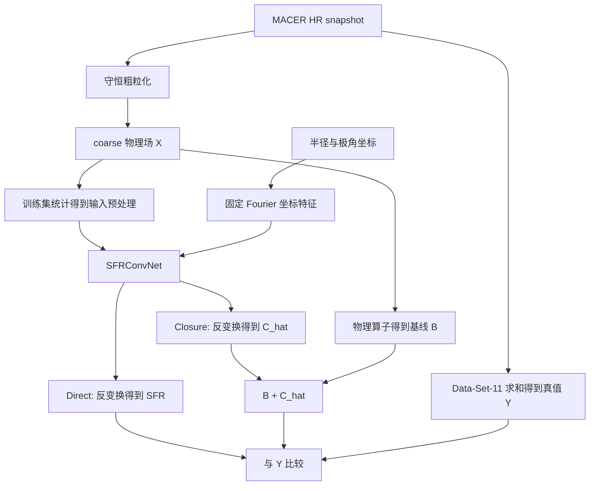

# MACNet 中期答辩：深度学习补课与评审问答

> 面向读者：物理系学生，接触过深度学习，但可能存在基础知识缺口。  
> 核对日期：2026-10-25。以当前二维 `SFRConvNet`、Direct/Closure、Exp1/Exp2/Exp3 为主。  
> 使用方式：先理解，再用自己的话复述。文中的“建议回答”是表达模板，不能把尚未完成的实验说成已经做过。

快速跳转：[课题表述](#1-先把自己的课题讲明白) · [模型框架](#2-你现在真正使用的模型框架) · [基础知识](#3-从物理学生熟悉的函数拟合开始补基础) · [模块原理](#4-模型里的每项技术究竟在做什么) · [损失函数](#5-两条路线的训练目标这是最需要讲准确的部分) · [训练流程](#6-训练过程从数据到最终-checkpoint) · [数据泄漏](#7-数据划分与泄漏ai-评审很可能在这里追问) · [结果解读](#8-如何读结果以及现在能说到哪一步) · [其他模型](#9-ai-评审可能提到的其他模型和概念) · [27 个评审问题](#10-面向-ai-行业评审的重点问答) · [十张记忆卡](#11-答辩前最后十张记忆卡) · [口头自测](#12-口头自测术语表与答辩材料准备) · [证据与验证范围](#13-项目依据原始资料与本次核对范围)

## 0. 时间紧张时，先读什么

| 可用时间 | 阅读顺序 | 要达到的程度 |
|---|---|---|
| 30 分钟 | 第 1、2、5、8、11 节 | 能讲清任务、网络、训练目标、泛化边界和十个关键回答 |
| 2 小时 | 再读第 3、4、6、7 节 | 能解释每个主要模块和训练步骤，不混淆基本概念 |
| 半天 | 通读第 9、10、12、13 节并口头自测 | 能应对 AI 评审追问，并知道哪些结论证据不足 |

**先记住一条回答原则：先说本项目具体做了什么，再解释通用原理，最后说证据和局限。**

例如，别人问“为什么用注意力”，不要从大模型开始讲。应先答：“我的主 CNN 使用 SE 通道注意力，对中间特征通道进行样本相关的重标定；它没有执行 Transformer 那种所有网格两两交互的自注意力。是否有收益，需要去掉 SE 的消融实验验证。”

### 0.1 本文的证据标记

- **[代码]**：本次直接阅读当前源码得到的实现事实。
- **[metadata]**：本次读取指定 cache 的 JSON sidecar 得到的配置事实；不表示重新检查了全部张量或原始数据。
- **[已有记录]**：来自训练历史或研究计划中的已记载结果；本次没有重新训练或重新评估 checkpoint。
- **[原理]**：通用数学或深度学习知识；关键技术附原始论文或官方文档。
- **[建议]**：答辩表达、诊断方案或后续实验，不表示项目已经实现。

本次只新增学习材料，没有修改模型、数据、cache、checkpoint 或训练历史。源码核对基准为当前工作区，Git HEAD 为 `fc8d5be2f9dffd26b58401fb50c5b268b2656dae`；历史结果应按当时保存的配置解释。

## 1. 先把自己的课题讲明白

### 1.1 30 秒版

> 我的研究尝试从低分辨率气体场中预测未解析的小尺度恒星形成效应。目前先在 MACER 高分辨率模拟上构建守恒粗粒化输入，预测单个 snapshot 的总瞬时 SFR。比较两条路线：直接预测 SFR，以及先计算低分辨率物理基线，再学习可正可负的闭合修正。当前重点是检验分布内拟合、未见模拟运行和核区域外数据上的表现；接入真实 GIZMO/MFM 仍是后续工作。

### 1.2 2 分钟版：问题、方法、验证、边界

1. **问题**：SFR 对密度、温度等量有非线性和阈值依赖。先平均再套公式，通常不等于先在细网格计算再求和。粗网格丢失的内部结构会形成闭合误差。
2. **数据**：由 HR 气体场生成守恒 coarse 场。真值来自 HR 的 Data-Set-11，逐格直接求和，不再乘体积；它是瞬时 SFR，不是日志中的累计新恒星质量。
3. **方法**：主模型是带坐标 Fourier 特征、残差卷积和 SE 通道注意力的二维 CNN。输入整个粗网格，输出每个 snapshot 一个标量。Direct 输出 SFR 的变换值；Closure 输出闭合项的变换值，再组合成最终 SFR。
4. **验证**：与 MACER-LR 物理基线及 Direct 对照比较；区分随机 snapshot 测试、留出运行和 torus 域外测试，并同时看物理空间误差与不同物理阶段的误差。
5. **边界**：filtered-HR 输入与真实低分辨率求解器输出有差异。当前标量模型也尚未解决逐单元源项分配和时间推进稳定性，不能直接称为可部署的 GIZMO 亚网格模型。

### 1.3 数学上究竟学什么

定义：

\[
X_\alpha=\mathcal R_\alpha(U_{\rm HR}),\qquad
Y=\sum_{j\in\mathrm{HR}}\mathrm{SFR}^{\rm cell}_j,
\]

\[
B_\alpha=\mathcal S_\alpha(X_\alpha),\qquad
C_\alpha^{\rm true}=Y-B_\alpha.
\]

| 符号 | 直观含义 | 来源 |
|---|---|---|
| \(U_{\rm HR}\) | 高分辨率气体状态 | 原始模拟 |
| \(\mathcal R_\alpha\) | 按某种尺度/算子粗粒化 | 数据处理流程 |
| \(X_\alpha\) | 模型能看到的粗分辨率场 | 网络输入 |
| \(Y\) | HR 真值总 SFR | Data-Set-11 保守求和 |
| \(\mathcal S_\alpha\) | 在粗状态上运行的 MACER-like SFR 算子 | 显式物理计算 |
| \(B_\alpha\) | 不使用神经网络时的物理基线 | 输出组合支路 |
| \(C_\alpha^{\rm true}\) | 粗状态物理基线与 HR 真值的差额 | 监督信息，可正可负 |

Direct：\(X_\alpha\to\widehat Y\)。Closure：\(X_\alpha\to\widehat C\)，最终 \(\widehat Y=B_\alpha+\widehat C\)。网络实际输出与物理量之间还有数值变换，见第 5 节。

**为什么 closure 可以是负数？** 因为低分辨率基线可能高估，也可能低估 SFR。例如 \(Y=2,B=5\)，就需要 \(C=-3\)。非负的是最终物理 SFR，不是修正项。

**为什么会有闭合误差？** 用玩具非线性 \(f(\rho)=\rho^2\) 说明：两个等体积小格密度为 0 和 2，细网格平均的 \(f\) 为 2，而平均密度为 1，\(f(1)=1\)。真实 SFR 算子更复杂，但“非线性运算与粗粒化不交换”的逻辑相同。这是示意推导，不是本项目的 SFR 定律。

### 1.4 当前任务的准确分类

| 术语 | 本项目怎么对应 |
|---|---|
| 监督学习 | 有输入 \(X\) 和模拟真值 \(Y\)，通过误差训练 |
| 回归 | 输出连续数值，不是分类标签 |
| 场到标量 | 输入二维多通道场，输出一个全局 SFR 或 closure 标量 |
| 物理基线修正 | Closure 显式组合物理模型与学习项 |
| 分辨率条件闭合 | 目标随粗粒化表示和尺度而变；固定 \(R_h\) 实验只是固定条件的特例 |
| 离线学习 | 使用预先生成的模拟数据训练，目前没有接入求解器闭环演化 |

**不能直接换成的说法**：当前网络不是输出 HR 图像的超分辨率模型，不是时间序列预测器，也不是已经部署的三维神经算子或完整 PINN。

## 2. 你现在真正使用的模型框架

### 2.1 总流程图



训练时还使用真值来计算损失；**推理时不需要 \(Y\) 或 \(C^{\rm true}\)**。Closure 推理仍需获得 \(B\)，并保留相同 baseline 算子、单位和所需上下文。

### 2.2 输入有哪些？不要背一个脱离 cache 的固定通道数

**[metadata]** 本次抽查 `.cache/Exp3_Rh12x20_FiveRuns_Closure_auto_metadata.json`，其基础输入有 12 个通道：

| 类型 | 通道 |
|---|---|
| 热力学与冷却 | `cooling_rate_density`、`cooling_time`、`density`、`gas_energy`、`temperature` |
| 引力相关 | `radial_acceleration`、`theta_acceleration` |
| 速度 | `v1`、`v2`、`v3` |
| 质量与几何 | `gas_mass`、`grid_volume` |

`density` 是质量密度，`gas_energy` 是内能密度。二维轴对称仍保留方位速度 `v3`。某些特征存在物理冗余，如 \(m=\rho V\)、二维 \(T=93e/\rho\)；这不自动构成标签泄漏，但需要特征消融检验必要性与迁移性。

**[metadata]** 抽查的 Exp3.2 cache 额外包含 3 个几何通道，共 15 个：

\[
\log_{10}\!\frac{r}{1\,\mathrm{kpc}},\qquad
\log_{10}\!\frac{\Delta r}{1\,\mathrm{kpc}},\qquad
\log_{10}\!\frac{r\Delta\theta}{1\,\mathrm{kpc}}.
\]

Exp3.1 只追加其中的绝对半径通道。几何通道已经取对数，只使用训练集统计标准化，不再次 `log1p`，不逐帧重新 min-max。

**答辩要点**：“我的输入通道由所汇报 checkpoint 与对应 cache 的 metadata 确定。不能用模型构造函数示例里的 `c_in=11` 或旧模型的 15 通道默认值代替真实配置。”

关于冷却特征的边界：二维当前 cache 允许这些量作为输入，但仍需说明目标代码能否独立计算它们；不能把未来量、SFR 或 closure 的派生值混进去。三维有独立输入契约，不能沿用这张二维表。

### 2.3 SFRConvNet 的实际组成

**[代码]** `Experiment/models.py::SFRConvNet` 的主干是：

```text
x 与 Fourier 坐标通道拼接
  ↓
Stem：3×3 Conv → BatchNorm → ReLU
  ↓
多阶段残差卷积块，含 SE 与 Dropout2d
  阶段之间：第一个块 stride=2；通道数翻倍
  可选 FiLM：只在合法的活动条件下启用
  ↓
AdaptiveAvgPool2d(1) → Flatten → LayerNorm
  ↓
Linear → GELU → Dropout → Linear
  ↓
每个 snapshot 一个无界标量
```

`prediction_mode` 指定输出语义，不会在模型内部完成反变换或加 baseline。**Direct 和 Closure 的网络头都没有保证非负的 Softplus。**

### 2.4 张量是什么？沿网络跟踪一次形状

张量可理解为带多个索引的数组。PyTorch 二维卷积采用：

\[
x\in\mathbb R^{N_b\times C\times H\times W}.
\]

- \(N_b\)：本 batch 的 snapshot 数；不是物理 baseline \(B\)。
- \(C\)：输入或中间特征通道数。
- \(H=N_\theta, W=N_r\)：二维数组的角向与径向格点数。
- 一个训练样本是一整个 snapshot，不是一个像素。12×20 格点不等于 240 个独立监督样本。

用 **Exp3.2 的一个教学配置** 举例：`c_in=15`、`base_ch=32`、`stage_depths=(2,2,2,2)`、`pos_num_bands=8`。其中网络宽度和频带数对应训练历史中的 Exp3.2 记录；这里的形状是按源码推导，没有声称重新执行了该 checkpoint。

Fourier 位置通道数为 \(D_{\rm pos}=2+4K=34\)，因此：

| 位置 | 张量形状 |
|---|---|
| 原输入 | \((N_b,15,12,20)\) |
| Fourier 特征 | \((N_b,34,12,20)\) |
| 拼接后 | \((N_b,49,12,20)\) |
| Stem / Stage 0 | \((N_b,32,12,20)\) |
| Stage 1 | \((N_b,64,6,10)\) |
| Stage 2 | \((N_b,128,3,5)\) |
| Stage 3 | \((N_b,256,2,3)\) |
| 全局池化与 Flatten | \((N_b,256)\) |
| 回归头 | \((N_b,1)\)，最后 squeeze 成 \((N_b,)\) |

奇数大小不会总是整除二：这里 3×5 经 `kernel=3,stride=2,padding=1` 得到 2×3。

`stage_depths=(2,2,2,2)` 表示 4 个阶段，每阶段 2 个残差块，共 8 块。每块包含 2 个 3×3 主分支卷积，所以是 16 个这样的块内卷积，此外还有 Stem、可能的 1×1 shortcut 及全连接层。不能简单称为“8 层网络”，也不宜未经定义就叫标准 ResNet-18。

### 2.5 两种“残差”必须区分

| 名称 | 公式 | 解决什么问题 |
|---|---|---|
| 网络内部残差连接 | \(h_{l+1}=P(h_l)+F_l(h_l)\) | 改善深网络优化，传递特征与梯度；\(P\) 是恒等映射或投影 |
| 物理 signed closure | \(\widehat Y=B+\widehat C\) | 修正粗分辨率物理基线与 HR 真值之间的差额 |

Direct 模型同样可以使用残差卷积块。网络内部有 ResNet shortcut，不代表学习目标就是物理 closure。残差学习的原始动机可参考 [ResNet 论文](https://arxiv.org/abs/1512.03385)。

## 3. 从物理学生熟悉的函数拟合开始补基础

### 3.1 神经网络可以先看作一个参数很多的试探函数

在最小二乘拟合中，你选择函数族 \(f(x;a,b,\ldots)\)，调整参数使数据误差小。神经网络也做这件事：

\[
\widehat y=f_\Theta(x),\qquad
\Theta^*=\arg\min_\Theta\frac1N\sum_{i=1}^N\ell(f_\Theta(x_i),y_i).
\]

差别主要是函数族通过多层线性运算和非线性组合构造，参数很多，而且很多“特征”随训练一起学习。

**“学习物理规律”是一个需要证据的解释，不是训练成功的自动结论。** 网络也可能学会模拟运行身份、网格特征、时间相关性等捷径。

### 3.2 参数、超参数、特征、标签

| 概念 | 本项目中的例子 | 谁决定 |
|---|---|---|
| 参数 parameter | 卷积核、Linear 权重、BN 的缩放与平移参数 | 反向传播与优化器更新 |
| 超参数 hyperparameter | 学习率、通道宽度、频带数、dropout、weight decay | 人设定或 HPO 搜索 |
| 输入特征 feature | 密度、速度、几何通道 | 数据与部署契约决定 |
| 标签/真值 target | HR 总 SFR；或对应的 closure 监督数据 | 模拟数据提供 |
| 特征图 feature map | 卷积得到的中间通道 | 网络计算得到，通常不是单一物理量 |

`base_ch=128` 的 128 是隐藏特征通道数，不是 128 个原始物理场。隐藏通道可能混合多个物理量的非线性组合。

### 3.3 一个“神经元”为什么需要非线性

最简单的一层是 \(h=\sigma(Wx+b)\)。如果每层只有线性变换，多层复合仍只是一个线性变换，无法充分表示阈值与复杂非线性。

| 激活函数 | 直观作用 | 当前主模型位置 |
|---|---|---|
| ReLU：\(\max(0,x)\) | 简单的分段非线性 | Stem、残差块 |
| SiLU：\(x\,\mathrm{sigmoid}(x)\) | 平滑非线性 | SE 小网络、FiLM conditioner |
| GELU：\(x\Phi(x)\) | 平滑门控，\(\Phi\) 为标准正态分布函数 | 回归头 |
| Sigmoid | 映射到 0–1，生成门控权重 | SE 的最后一层 |

这些非线性是表达工具。不要把 ReLU 的数学阈值直接解释为模型内置了恒星形成的物理密度阈值。

### 3.4 前向传播、损失、反向传播、更新

用单参数模型 \(\widehat y=wx\)、损失 \(L=\tfrac12(\widehat y-y)^2\) 演示：

\[
\frac{\partial L}{\partial w}=(wx-y)x,\qquad
w\leftarrow w-\eta\frac{\partial L}{\partial w}.
\]

若 \(x=2,y=6,w=1\)，则预测 2，梯度为 -8；取 \(\eta=0.1\)，更新到 \(w=1.8\)，预测变为 3.6，朝正确方向移动。

真实模型沿着“卷积 → 非线性 → 池化 → 输出 → 损失”的计算图应用链式法则。**反向传播负责算梯度，优化器负责依据梯度更新参数，两者不是同一个算法。** 自动微分也不是对每个参数做数值有限差分。

Closure 中 \(\widehat C=s_C\sinh(z)\) 是可微的：

\[
\frac{\partial\widehat C}{\partial z}=s_C\cosh(z).
\]

所以最终 SFR 的损失能反传到输出 closure 的网络；同时大 \(|z|\) 时梯度会变大，需要注意数值稳定性。

### 3.5 Batch、step、epoch

- **Batch**：一次一起送入网络的一组 snapshot。
- **Step**：通常指一个 batch 完成一次参数更新。
- **Epoch**：完成一轮训练迭代。普通不放回遍历时约看完训练集一次。

有放回重采样时，一轮可能重复部分样本并遗漏部分样本，不能逐字理解为“每个原始 snapshot 恰好用了一次”。当前 `run_time_balanced` 属于训练抽样策略，见第 7 节。

batch size 会影响梯度噪声、显存、每轮更新次数及 BN 统计。大 batch 不一定泛化更好；比较训练预算时，应同时看 epoch、更新步数和总计算量。

### 3.6 拟合、泛化、过拟合、欠拟合

| 现象 | 常见信号 | 应先检查什么 |
|---|---|---|
| 欠拟合 | 训练和验证都差 | 输入信息、目标定义、优化是否正常、模型容量 |
| 过拟合 | 训练继续变好，验证变差 | 数据量、相关性、模型容量、正则化、早停 |
| 分布外失败 | 训练/验证好，独立域很差 | 尺度、输入范围、物理参数、几何、标签口径、baseline 偏差 |
| 数据问题 | loss 异常、标签不一致、结果不合理 | 单位、守恒、NaN、坏帧、UID、预处理契约 |

训练与验证曲线只能提供线索。相邻帧被随机拆开时，验证曲线很好也可能高估真实泛化。域外失败也不等于一定是模型“过拟合”了，需要逐项诊断。

## 4. 模型里的每项技术，究竟在做什么

### 4.1 卷积 CNN：为什么适合二维气体场

卷积在局部邻域共享一组权重。一个输出特征通道可写成：

\[
h_{o,i,j}=\sigma\left(b_o+\sum_c\sum_{u,v}W_{o,c,u,v}x_{c,i+u,j+v}\right).
\]

它把空间相邻关系作为先验，用较少参数识别局部结构，再逐层组合成更大尺度特征。这里的“图像”是多通道物理场，不是 RGB 照片。

**建议回答**：“我选择 CNN 是因为输入保留二维局部结构，卷积具有局部连接与参数共享，适合作为当前数据规模下的基线。它是否优于更简单模型或 Transformer，仍需相同数据划分和预算的对照。”

必须补充两个限制：普通卷积在理想条件下具有平移等变性，有限边界、padding、stride 会影响这种性质；球极坐标里相同索引位移不等于相同物理距离，所以普通 3×3 卷积不是固定 pc 尺度的物理卷积。

卷积尺寸公式与参数定义见 [PyTorch Conv2d 文档](https://docs.pytorch.org/docs/2.14/generated/torch.nn.Conv2d.html)。

### 4.2 Kernel、stride、padding、感受野

| 名称 | 含义 | 本项目例子 |
|---|---|---|
| kernel | 每次读取的局部窗口 | 3×3 主卷积；1×1 shortcut 投影 |
| stride | 窗口移动步长 | 阶段切换用 2，下采样 |
| padding | 边界补值 | 3×3 卷积 padding=1 |
| 感受野 | 某个输出可能依赖的输入范围 | 随叠层与下采样扩大 |

感受野是索引空间概念，不自动对应统一物理长度。若只算卷积路径，可以递推 \(r_l=r_{l-1}+(k_l-1)j_{l-1}\)、\(j_l=s_lj_{l-1}\)；但本模型还有 SE 全局池化，完整依赖已经包含全局信息，不能仅用“3×3 堆了几次”概括全部依赖。

1×1 卷积主要混合通道或对齐 shortcut 的尺寸，不直接扩大局部窗口。边界的 zero padding 也不是经过证明的球极坐标物理边界条件。

### 4.3 残差块 ResNet：让优化更容易

基本形式是 \(h_{l+1}=h_l+F_l(h_l)\)。当维度变化时用投影 \(P(h_l)\)。恒等 shortcut 给信息和梯度提供直接路径，帮助缓解深层网络的优化困难；它不保证不会梯度消失，也不保证不会过拟合。[ResNet 原论文](https://arxiv.org/abs/1512.03385)

**[代码]** 本项目 `ConvFiLMBlock` 的准确顺序：

```text
主支路：BN1 → ReLU → Conv1 → BN2 → [可选 FiLM]
       → ReLU → Dropout2d → Conv2 → SE
旁支路：Identity，或带相同 stride 的 1×1 Conv
输出：两条支路相加
```

当前实现相加后没有额外 ReLU。FiLM 在 BN2 后、第二个卷积前；不要照旧 docstring 把位置讲成 BN1 后。

### 4.4 SE：注意的是隐藏通道，不是直接给物理量排名

SE 先对每个特征通道做全局平均，得到摘要，再用小型全连接网络生成 0–1 的门控权重：

\[
q_c=\frac1{HW}\sum_{i,j}h_{cij},\qquad
a=\mathrm{sigmoid}(W_2\,\mathrm{SiLU}(W_1q+b_1)+b_2),
\]

\[
\widetilde h_{cij}=a_ch_{cij}.
\]

**建议回答**：“SE 根据当前样本的全局特征摘要调节通道响应，让网络能选择性强调某些中间特征。这里的通道是学习到的表示，不能把门控权重直接解释为密度或温度的因果重要性。”

**[代码]** SE 中间宽度为 `max(channels // reduction, 8)`。`se_reduction` 越大通常意味着门控网络更窄，但受最小宽度 8 限制，不能无限按比例缩小。模块动机见 [SE 原论文](https://arxiv.org/abs/1709.01507)。

### 4.5 Fourier 坐标特征：不是 FFT，也不是 FNO

网络把坐标映射为多频率正弦、余弦特征，再拼接到物理场通道。它向共享卷积核提供位置线索，增加表达空间变化的便利性。

**[代码]** 频率 \(f_k\) 在 1 到 `pos_max_freq` 间对数等距取 `pos_num_bands=K` 个；频率本身作为 buffer 保存，不参与梯度学习。当前主 CNN 设置 `theta_pi_periodic=False`，保留两个坐标，所以 \(D_{\rm pos}=2+4K\)。

当前具体使用：

\[
u_r=\frac{\ln(\max(r,\epsilon))-\min\ln(\max(r,\epsilon))}
{\max\ln(\max(r,\epsilon))-\min\ln(\max(r,\epsilon))+\epsilon},
\]

\[
\sin(2\pi f_ku_r),\ \cos(2\pi f_ku_r),\qquad
\sin(2f_k\theta),\ \cos(2f_k\theta).
\]

半径归一化是**逐样本**做的。角度分支先做代码中的角度映射，主 CNN 关闭强制 \(\pi\) 周期模式；不能据使用 sin/cos 就说网络严格实现了正确的球极角边界或物理对称性。

关键区分：

- **Fourier 特征**：对坐标求 sin/cos，当前使用。
- **FFT**：把一组场值变换到频域；当前坐标模块没有做这种场的 FFT。
- **FNO**：通过频域算子层学习函数到函数的映射；当前 `SFRConvNet` 没有这种层。

Fourier 映射的相关研究讨论了坐标网络的频谱偏置，但那不能直接证明本项目 CNN 的最优频带数。[Fourier Features 原论文](https://arxiv.org/abs/2006.10739)

**为什么频率不是越高越好？** 离散网格无法可靠辨识任意高频，可能出现混叠或相似编码；高频也可能帮助记住训练网格。实际应由训练/验证内的受控实验选择。`pos_max_freq=101` 没有 pc⁻¹ 的直接物理含义。

**本项目最重要的限制**：逐样本归一化径向坐标使两个不同绝对半径范围都被映射到 0–1。原 Fourier 编码本身没有显式保留统一的绝对半径；其他物理/体积通道可能提供间接线索，但不能保证足以恢复尺度。Exp3.1/3.2 为此追加固定 kpc 参考下的尺度信息；提供信息不等于保证域外泛化。

### 4.6 FiLM：让网络知道条件，而不是把 baseline 偷喂进去

FiLM 用条件变量 \(q\) 生成通道缩放和平移。当前块中为：

\[
h'=(1+\gamma(q))\odot h+\beta(q).
\]

**[代码]** `ConvFiLMConditioner` 用一个小 MLP 产生每个 stage 的 \(\gamma,\beta\)，在空间维广播，同一 stage 的块使用该 stage 的调制参数。概念来源见 [FiLM 原论文](https://arxiv.org/abs/1709.07871)。

本项目条件语义必须讲准确：

- 固定单分辨率 \(R_h\)：`conditioning=none`，FiLM 关闭。
- 当前 \(R_m\) 训练路径：活动条件是 `log10(M_filter)`；训练入口要求启用 FiLM，使条件实际进入模型。
- baseline \(B\) 只参与输出组合，不作为当前 SFR 主 CNN 的输入条件。
- 旧吸积率模型使用黑洞质量条件，不能套到当前 SFR 实验。

**建议回答**：“FiLM 是支持分辨率条件的一种机制。我汇报的固定 Rh 模型没有启用它，因此不能把当前实验效果归功于 FiLM。”

代码中某些旧函数变量仍叫 `y_baseline`，属于命名遗留；实际物理含义以训练传参和 metadata 为准。

### 4.7 三种归一化分别做什么

| 方法 | 使用哪些统计量 | 当前作用 |
|---|---|---|
| 输入标准化 | 训练集每通道、跨样本与网格的均值/标准差 | 在数据进入网络前统一数值尺度 |
| BatchNorm2d | 训练 batch 内每通道跨 batch、H、W 的统计量 | 卷积特征的中间归一化；默认维护运行统计用于推理 |
| LayerNorm | 每个样本自身指定维度的统计量 | 池化后的隐藏特征归一化，不使用跨样本运行均值 |

这三者不能互相替代。“已经标准化，所以不需要 BN”或“用了 BN，就不必保存训练统计”都不成立。

BN 在训练和推理时行为不同，域外数据可能与运行统计不匹配；这是要诊断的因素，不能直接判定是 torus 失败的唯一原因。LayerNorm 不依赖 batch 统计，也不意味着对分布偏移免疫。[BatchNorm2d 文档](https://docs.pytorch.org/docs/2.14/generated/torch.nn.BatchNorm2d.html)、[LayerNorm 文档](https://docs.pytorch.org/docs/2.14/generated/torch.nn.LayerNorm.html)

### 4.8 Dropout 与其他正则化

Dropout 在训练时随机屏蔽部分激活，降低网络依赖特定特征组合的程度；常规推理时关闭。当前卷积块用 `Dropout2d`，对每个样本随机屏蔽整张特征通道；回归头用普通 Dropout，屏蔽元素。[Dropout2d 文档](https://docs.pytorch.org/docs/2.14/generated/torch.nn.Dropout2d.html)

常规单次输出没有自动变成概率分布。若要用 MC Dropout 估计不确定性，需额外设计推理流程并校准，同时注意 BN 模式；当前不能宣称已经有可靠置信区间。

正则化还包括 weight decay、容量限制和早停。它们可能抑制过拟合，但不能补回缺失的物理信息，也不能替代严格的数据划分。

### 4.9 全局平均池化：把整张图压成一个向量

`AdaptiveAvgPool2d(1)` 对最后的每个特征通道取空间平均，得到固定长度向量，再用 MLP 输出标量。这降低了输出头参数量，匹配当前全局目标。

**关键限制**：平均的是学习到的特征，不是按真实体积积分 SFR 密度。提供 `grid_volume` 输入可让网络利用几何信息，但不会自动赋予严格积分或守恒结构。全局总 SFR 很准，也不证明空间分布正确；当前网络根本没有输出逐格 SFR。

自适应池化能在接口上接收不同空间 shape，不代表模型已经实现分辨率无关泛化。改变粗粒化分辨率仍需重建数据/cache，并专门验证。

## 5. 两条路线的训练目标：这是最需要讲准确的部分

### 5.1 输入变换与目标变换是两件事

输入预处理改变的是密度、速度等输入特征的数值尺度；目标变换改变的是输出和损失所在的空间。

**[代码]** 输入先按训练集确定 `log1p` 掩码，再逐通道标准化：

\[
x'_c=\frac{g_c(x_c)-\mu_c^{\rm train}}{\sigma_c^{\rm train}}.
\]

当前普通物理通道的 `log1p` 资格由训练数据非负性等规则确定，不是所有量无差别取对数；已取固定参考 `log10` 的几何通道被排除。验证/测试复用训练掩码和统计；若某通道按训练集被声明为非负并取 `log1p`，测试出现负值时会报错，不能偷偷重新选择变换。

标准化不等于把每帧都压到同一形状或相同取值范围。输入经标准化后，域外数据仍可能远超训练分布。

### 5.2 Direct：常用的是对数目标上的 MSE

当前常见配置：

\[
z_Y=\log_{10}\left(1+\frac{Y}{s_Y}\right),\qquad
\widehat z_Y=f_\Theta(X),
\]

\[
L_{\rm direct}=\frac1N\sum_i(\widehat z_{Y,i}-z_{Y,i})^2.
\]

反变换为：

\[
\widehat Y=s_Y\left(10^{\widehat z_Y}-1\right).
\]

这里 \(s_Y>0\) 与 SFR 有同样单位，让对数内无量纲；具体值查 metadata，不能与 closure scale 混淆。当前共享分析反变换默认把负物理预测裁为零，**这属于后处理，不是网络头的非负性保证**。

对数压缩动态范围，使高 SFR 不那么支配训练；大 SFR 时误差更接近关注倍数差异，但低 SFR 时 `log(1+Y/s)` 近似线性，不能说全域严格等价于最小化相对误差。

**重要数学事实**：在平方损失下，理想回归器逼近所选目标空间的条件均值。通常有：

\[
T^{-1}\!\left(\mathbb E[T(Y)\mid X]\right)\ne\mathbb E[Y\mid X].
\]

因此，对数空间拟合很好不保证物理空间无偏，也不保证高峰绝对误差小。不能只比较两个实验打印出的 loss。

### 5.3 Closure：输出经过 asinh 参数化，主损失却在最终物理 SFR 上

**[代码]** 当前 `closure_training_loss` 的流程是：

\[
z_C=\operatorname{asinh}(C^{\rm true}/s_C),\qquad
\widehat z_C=f_\Theta(X),
\]

\[
\widehat C=s_C\sinh(\widehat z_C),\qquad
\widehat Y=B+\widehat C.
\]

对常用 `loss=l1, weight_mode=none`：

\[
L_{\rm primary}=\frac1N\sum_i
\left|\frac{\widehat Y_i-Y_i}{s_C}\right|,
\]

\[
L_{\rm neg}=\frac1N\sum_i
\left[\frac{\max(-\widehat Y_i,0)}{s_C}\right]^2,
\qquad
L=L_{\rm primary}+\lambda_{\rm neg}L_{\rm neg}.
\]

如果选 MSE/Huber，主误差使用对应函数，仍作用于 \(\widehat Y/s_C\) 与 \(Y/s_C\)。

**最容易说错的一句**：“我的 Closure 模型最小化 asinh 空间中预测 closure 与真 closure 的 L1。”——这不符合当前代码。当前变换后的 closure target 在此函数中用于 batch 形状/契约检查；主训练梯度来自最终 SFR 的物理误差和非负软惩罚。

asinh 的作用：奇函数、允许正负，零附近近似线性，远离零时近似带符号对数。当前它是输出的可逆参数化，**不意味着训练主损失已被转到对数误差空间**。

### 5.4 closure scale 从哪里来？为什么不能从测试集估计？

**[代码]** `closure_scale=auto` 仅由训练集计算：

\[
s_C=\operatorname{median}_{i\in\mathrm{train}}|C_i^{\rm true}|.
\]

若中位数为零，则回退到非零绝对值的中位数；如果全部为零则停止，要求检查。不同折、数据版本或样本集合可以得到不同的 \(s_C\)。例如本次抽查的 Exp3.2 sidecar 记录约为 159.5951；这不是所有实验通用的物理常数。

测试标签一旦参与尺度选择，就会让测试分布的信息影响训练流程。即使没有把标签直接拼到输入，这也是泄漏。

**更深的追问**：scale 只是在“换单位”吗？对固定物理预测而言，L1 主项按 \(1/s_C\) 缩放，平方负值惩罚按 \(1/s_C^2\) 缩放，且输出参数化也改变。因此跨实验比较 loss 和固定 \(\lambda\) 的效果时，应核对实际 scale，不能直接把 loss 的高低当成物理精度排名。

### 5.5 为什么不用 ReLU 把 closure 或最终输出直接截成正数

- closure 本来就允许负值；截成非负会禁止修正过高 baseline。
- 对最终 SFR 硬截断会改变误差分布，且截断区可能没有有用梯度。
- 当前 Closure 保留原始 \(B+\widehat C\)，对负值加软惩罚，因此**仍可能出现负预测**。

可讨论把最终 SFR 用 Softplus 参数化等后续方案，但那会改变模型/训练契约，需要重新训练和比较；不能描述成当前实现。

### 5.6 L1、MSE、Huber：先说损失空间，再说损失名称

令残差 \(e=\widehat y-y\)：

| 损失 | 公式或形状 | 优点 | 局限 |
|---|---|---|---|
| MSE | \(e^2\) | 大误差惩罚更强，梯度随误差增大 | 容易被极端值主导 |
| L1/MAE | \(|e|\) | 对少量极端残差较稳健 | 对灾难性大误差只线性增长，可能削弱峰值 |
| Huber | 小残差二次、大残差线性 | 折中 | 需要选择转折尺度 \(\delta\) |

Huber 可写为 \(\tfrac12e^2\)（\(|e|\le\delta\)）及 \(\delta(|e|-\tfrac12\delta)\)（其余区域）。理想条件下，MSE 对应条件均值，L1 对应条件中位数；这解释了为什么它们可能对爆发峰值表现不同。它们都不自动给出单样本误差条。

**建议回答**：“我目前比较的是 Direct+log-MSE 与 Closure+physical-L1 的完整方案。预测路线、损失空间、损失形式和最优超参数都可能影响结果。若要证明 Closure 结构本身的收益，需要统一物理评价空间并做受控消融。”

### 5.7 baseline 固定时，为什么还说 Closure 有物理意义

若没有负值惩罚，而且直接采用物理 L1/MSE，则：

\[
\widehat Y-Y=B+\widehat C-Y
=\widehat C-C^{\rm true}.
\]

所以固定同一个 \(B\) 后，物理误差的代数形式一致；Closure 的优势**不能仅凭这个等式得到证明**。它提供了一种“已知物理部分 + 学习修正”的分解和归纳偏置，可能让某些问题更易学或更可解释，但 baseline 很差时网络还得抵消大偏差。

当前 baseline 也不是已被证明完美的真实 LR 模拟：它是具有明确版本和近似的 MACER-like 算子。Closure 可能同时吸收粗粒化效应、baseline 近似误差及缺失信息引起的统计偏差。必须先审计 baseline，不能把所有修正都命名为纯粹的新物理。

## 6. 训练过程：从数据到最终 checkpoint

### 6.1 一次完整实验的正确顺序

1. **冻结问题**：输入可获得性、标签定义、粗粒化版本、目标路线、单位和评价指标。
2. **准备数据**：raw → fine → coarse，检查守恒、有限值、正体积、\(Y=B+C\) 和来源身份。
3. **划分集合**：按预定 split 生成 train/validation/test/out，检查 `sample_uid` 与 `parent_hr_uid` 不交叉。
4. **拟合预处理**：只用 train 确定输入变换/标准化与自动 closure scale，然后应用到其他集合。
5. **训练与调参**：train 更新权重，validation 选择超参数、epoch 和早停；HPO 不读取测试标签。
6. **正式重训练**：固定选择好的配置，运行预定随机种子，保存最优验证 checkpoint。
7. **最终评价**：加载最佳验证 checkpoint，在预定测试域上与 baseline 比较，报告全部有效样本和失败情况。

CachePT 是训练张量与契约的缓存，不是额外的学习模型。metadata 用于保证“拿对数据、按同一语义解释数据”，本身不证明预测准确。

### 6.2 一个 batch 内到底发生什么

```python
# 教学伪代码，表达当前训练逻辑，不是可直接复制运行的完整脚本
model.train()
for batch in train_loader:
    x, coord, target, baseline = 读取当前批次(batch)
    optimizer.zero_grad()
    z_pred = model(x, coord)
    if objective == "signed_closure":
        c_pred = closure_scale * sinh(z_pred)
        y_pred = baseline + c_pred
        loss = 物理误差(y_pred, target) + 负SFR软惩罚(y_pred)
    else:
        loss = 目标变换空间误差(z_pred, target)
    loss.backward()
    裁剪梯度范数()
    optimizer.step()
    scheduler.step()
```

AMP 会增加缩放与取消缩放步骤；原理不变。当前真实函数签名与 batch 布局见源码，不能把这段教学伪代码当作训练入口。

### 6.3 AdamW：如何更新参数

SGD 沿当前梯度下降；Adam 利用梯度一阶矩与平方梯度二阶矩的滑动统计，给不同参数自适应的更新尺度。AdamW 将权重衰减与损失梯度的自适应更新分开。它常用于改善优化，但不保证全局最优或最佳泛化。[AdamW 原论文](https://arxiv.org/abs/1711.05101)

**建议回答**：“AdamW 用历史梯度统计调节参数更新，并独立施加权重衰减。我通过验证集选择学习率和 weight decay，而不是认为某个默认值必然适合物理数据。”

**避免错误**：AdamW 不应简单等同于“Adam 的 loss 加了 L2”。对自适应优化器，二者一般不等价。训练入口目前把 `model.parameters()` 统一交给 AdamW，没有显式设置‘归一化参数和 bias 不衰减’的参数组。

### 6.4 学习率、warmup、cosine

学习率控制单步更新幅度。太大可能震荡或数值不稳定，太小可能收敛慢或在给定预算内训练不足。

当前使用线性 warmup 后余弦下降。衰减段可写为：

\[
\eta_t=\eta_{\min}+\frac12(\eta_{\max}-\eta_{\min})
\left[1+\cos(\pi p_t)\right],\qquad p_t\in[0,1].
\]

warmup 让训练初期的更新逐步增强，不是增加额外预训练数据。当前 scheduler 按 batch step 更新。`lr_warmup_steps=0` 时，如果 `lr_warmup_ratio>0`，仍会按比例预热；要关闭需同时核对 ratio。

### 6.5 梯度裁剪、AMP、随机种子

| 技术 | 作用 | 不能误解为 |
|---|---|---|
| 梯度范数裁剪 | 当前用全局梯度范数阈值限制极端更新；方向基本保留，整体缩放 | 把所有权重或每个梯度元素裁到 ±0.3 |
| AMP 自动混合精度 | 部分计算用较低精度，配合梯度缩放节约显存/计算 | 改变物理单位、保证数值完全相同 |
| 固定 seed | 控制初始化、抽样等随机过程，便于复现 | 证明结果对随机性不敏感、自动保证跨硬件逐位一致 |

当前 closure 的 `sinh` 解码转为 float32，以降低 float16 溢出风险；这不能保证任意大输出都不会溢出。AMP 下应先取消梯度缩放，再裁剪，当前训练代码采用这一顺序。

### 6.6 验证、早停与最佳 checkpoint

验证阶段用 `model.eval()` 并关闭梯度计算，停止 dropout，BN 默认使用运行统计。`eval()` 与 `no_grad()` 负责不同的事情，一个切换层行为，一个停止记录梯度。

**[代码]** 当前 `eval_epoch` 先算每个有效运行组的平均 loss，再对运行组等权平均：

\[
M_{\rm val}=\frac1G\sum_{g=1}^G
\left(\frac1{N_g}\sum_{i\in g}\ell_i\right).
\]

这个指标用于最优 checkpoint 与 early stopping，不是总体 \(R^2\)，也不等于把所有样本直接混合平均。它降低了样本多的运行主导选择的程度，但不是严格的最坏域优化。

`patience=15` 表示连续约 15 个 epoch 没有满足改善规则就早停，不是固定只训练 15 轮。测试时加载最佳验证 checkpoint，不是自动使用最后一轮。保存权重也不等于所有实验契约已复现，仍需保存模型配置、预处理、split、代码版本及单位。

### 6.7 Optuna / HPO：外层找配置，内层学权重

HPO 是 Hyperparameter Optimization。一个 trial 是一套超参数的训练和验证；许多 trial 共同组成 study。

当前搜索包含 `base_ch`、`se_reduction`、Fourier 频带/最大频率、dropout、学习率、weight decay、batch size；目标路线和 loss 是同一个 study 中固定的实验条件。支持固定部分参数或只搜索子集。

- **TPE**：利用已有 trial 的验证表现，分别估计较好/其余配置的参数分布，引导下一次采样；不保证每种离散组合都覆盖，也不保证全局最优。[Optuna 官方 TPE 文档](https://optuna.readthedocs.io/en/stable/reference/samplers/generated/optuna.samplers.TPESampler.html)
- **Grid**：遍历预定有限组合。当前 Fourier 子网格为 3 个频带数 × 6 个最大频率 = 18 种；多个 seed 是重复实验维度。

**不要说 Optuna 会自动证明架构最优，也不要把 early stopping 说成已经实现了 Optuna 的逐轮 pruning。** 当前脚本没有据此宣称 trial pruning 的依据。

搜索本身也可能对验证集过拟合。控制预算、保留独立最终测试，必要时用嵌套验证；一个最优 trial 的分数不是最终测试性能。模型 seed 也不是挑选最好结果的超参数，应报告预定 seed 集的均值、离散程度和失败情况。

## 7. 数据划分与泄漏：AI 评审很可能在这里追问

### 7.1 各实验到底证明什么

| 实验 | 当前划分 | 能提供的证据 | 主要限制 |
|---|---|---|---|
| Exp1 | 组内随机 snapshot 60/20/20 | 同来源运行随机留出下的拟合/插值能力，代码参考 | 相邻时间帧相关，不能称严格时间外推 |
| Exp2 | leave-one-galaxy-out，保存 train/val/test/out | 未见模拟运行/配置的泛化能力 | 折内 train/val/test 仍可能是随机帧；训练来源有限 |
| Exp3 | Zou 五组按运行分层随机 75/25；torus 唯一 test-only | 对独立核区盘/环面域的域外表现 | Zou validation 仍非时间外推；torus 同时改变多种条件 |
| Exp3.1/3.2 | 继承 Exp3；追加绝对几何通道 | 几何尺度输入消融 | 必须控制数据版本、预算与超参数，不能单凭一次结果归因 |

Exp2 应把“训练来源内的测试”与“真正留出的 out 运行”分开报告，不要看到 `test.pt` 文件名就认定是域外数据；以对应折 manifest 和 metadata 的组身份为准。五组模拟运行也不是五个观测星系的独立随机样本。

### 7.2 UID 无交叉为什么还不够

`sample_uid` 保证当前物理产品身份不混用；`parent_hr_uid` 用于识别来自同一 HR 帧的不同 coarse 产品。同一帧不同分辨率不能分到 train 与 test。

但两张相邻时刻的 snapshot 可以 UID 完全不同、物理状态却高度相关。UID 隔离排除直接重复，**不保证统计独立**。严谨时间泛化需要连续时间块、时间间隔 gap，并用真实时间戳核对，而不是只按文件编号乘固定 cadence。

### 7.3 泄漏的五种常见形式

1. **标签泄漏**：SFR、closure、标签派生量或未来量进入输入。
2. **同源泄漏**：同一 HR 帧的 coarse 变体出现在不同 split。
3. **预处理泄漏**：用全数据计算标准化、变换规则或 closure scale。
4. **选择泄漏**：看测试误差选择架构、epoch、阈值、seed 或输入通道。
5. **时间相关性导致的乐观偏差**：高度相似相邻帧随机拆开，实际评估难度远低于未来或新运行预测。

前四种应严格防止；第五种要准确说明当前估计的是哪种泛化，不把随机拆分结果扩大解释。

**冷却量、体积、质量与标签相关，不自动等于泄漏。** 关键是它们是否能在预测时独立获得，是否使用了标签或未来信息，以及训练与部署是否采用相同定义。反过来，“物理变量”这个名字也不能证明安全。

### 7.4 run_time_balanced 抽样为什么需要

不同运行 snapshot 数量和时间间隔不同，直接均匀抽帧会让输出更密集的运行/阶段占更大权重。当前 Exp3 训练让每个运行总抽样权重相同，在运行内部按 snapshot 代表的物理时间区间加权；validation/test 不重采样。

它是在定义训练的统计目标，不会制造新的独立信息，也不保证已覆盖所有物理阶段。抽样平衡和 loss 加权是两种不同机制，不能把 `sampling_mode=run_time_balanced` 误讲成必然使用了 `weight_mode` 的目标加权。

**[metadata]** 本次读取的 Exp3.2 sidecar 记录 train=19,596、validation=6,536、torus test=989。它们是 snapshot 数，不是独立宇宙学系统数，也不是当前所有实验的统一样本数。

### 7.5 torus 测试应怎么说

torus 是 1 pc–1 kpc 核区盘/环面，Zou 训练域约 100 pc–500 kpc；两者总 SFR 积分孔径不同，流入、时间尺度等也有差异。相同 72×280 原网格 shape 不代表相同物理分辨率。

torus 1000 帧中按原始 index 预先排除 11 个坏帧：`747, 754, 755, 763, 764, 765, 766, 767, 768, 769, 770`，保留 989 帧。排除必须发生在 raw→fine 前，不能根据模型误差临时删帧；这些帧也不独立，因为相邻输出间隔仅 100 yr。

**最重要的测试纪律**：torus 不进入 train/validation、归一化、尺度估计和 HPO。若看完 torus 后据此设计 Exp3.1/3.2，虽然没有拿标签反向传播，torus 已在研究迭代中成为可见诊断域，不能再把后续效果说成完全未触碰的最终盲测。应透明记录试验顺序，并争取另一个未见运行作为最终外部验证。

## 8. 如何读结果，以及现在能说到哪一步

### 8.1 常见指标各在问什么

\[
\mathrm{MAE}=\frac1N\sum_i|\widehat Y_i-Y_i|,\qquad
\mathrm{RMSE}=\sqrt{\frac1N\sum_i(\widehat Y_i-Y_i)^2},
\]

\[
R^2=1-\frac{\sum_i(\widehat Y_i-Y_i)^2}{\sum_i(Y_i-\overline Y)^2}.
\]

| 指标 | 适合看什么 | 容易误解的地方 |
|---|---|---|
| 物理 MAE | 平均绝对 SFR 误差 | 受 SFR 单位和量级影响 |
| 物理 RMSE | 对大失败更敏感 | 少量爆发帧可能主导 |
| \(R^2\) | 相对于用该评估集均值预测的平方误差改善 | 不是分类准确率，能为负；目标几乎不变时不稳定 |
| 对数空间误差 | 动态范围、近似倍数误差 | 不能替代物理 SFR 绝对误差 |
| 相对误差分位数 | 多数样本的倍数偏差与长尾 | 零/极低真值需注明筛选或 floor |
| 负预测比例 | 非物理输出出现频率 | Direct 若后处理裁剪，比例为零不说明原始输出合法 |
| 分组/阶段指标 | 哪种运行、低 SFR 或爆发期失败 | 总体平均可能掩盖局部失败 |

相关系数高不等于数值准确：\(\widehat Y=10Y\) 可以高度相关，但幅度系统性错十倍。

物理指标需标明单位。当前二维 1 code SFR = 0.025 \(M_\odot/\mathrm{yr}\)；MAE/RMSE 做同样倍数换算，MSE 要乘该倍数的平方，\(R^2\) 在一致线性换单位时不变。

### 8.2 已有 Exp1 结果可以怎么引用

**[已有记录，未在本次重新评估]** 研究计划第 30 节记载，Rh 8×8 两条正式路线在同一个 4,873 样本 Cached Test Set 上：

| 指标 | Direct + log-MSE | Closure + physical-L1 |
|---|---:|---:|
| 物理 RMSE，MACER code SFR 单位 | 26.4438 | 17.7567 |
| 物理 MAE，MACER code SFR 单位 | 11.8621 | 7.7072 |
| 物理 \(R^2\) | 0.996767 | 0.998542 |
| 中位绝对相对误差 | 2.6759% | 1.7662% |
| 负最终 SFR 比例 | 0，Direct 默认裁剪后 | 0.6567%，32 个样本 |

**建议回答**：“在这组随机 snapshot 测试及各自训练配置下，Closure 完整方案的物理误差更低。但这同时混入路线、损失空间和超参数差异，且是单次训练，不能证明 Closure 结构独立优越，也不能代表未见运行和真实 GIZMO 的性能。”

研究计划中的 target-space 比较还有有效样本筛选差异：Closure 的 32 个负值没有进入相应对数指标，物理指标保留全部样本。因此不能把不同有效样本数的指标不加说明并列。

### 8.3 Exp3 与几何消融目前不宜怎么解释

**[已有记录]** `Train_history.md` 中 Exp3 原 Closure 记录描述 torus 预测持续高约一个数量级；几何消融也有正式训练记录。记录中的 Exp3.1 与 Exp3.2 不仅输入不同，`base_ch`、Fourier 频带、dropout、学习率等配置也不同。

因此，不能仅根据记录的 `Test metric loss` 排出“几何改善了多少”的物理精度结论，更不能归因为半径或宽度这个单一因素。需统一最终物理 SFR 指标、样本、baseline、数据版本、scale 和训练预算，再做匹配对照或等预算 HPO 比较。

**数据版本也要核实**：本次抽查的 Exp3.2 metadata 指向 `coarse_rh_12x20_sfr_v7`；几何实验文档要求核验统一的时间/日志修复产品。目录名带 v7 本身不是“修复已验证”的证据。本次未逐个检查 HDF5 与生成日志，答辩不要补称所有旧时间上下文问题已解决。

### 8.4 该展示哪些图

**[建议，以下不是本次新生成的分析结果]**

1. 物理空间真值–预测散点图，画 \(y=x\)，同时放 baseline；若跨数量级，清楚处理零值。
2. 真实时间序列上的真值、baseline、模型曲线，保留缺帧和时间间隔，不用打乱后的样本序号冒充时间。
3. 每个留出运行/物理阶段的 MAE、RMSE、相对误差分位数。
4. 误差随真值 SFR、baseline 大小、\(|C|\)、半径/几何尺度或训练范围距离的变化。
5. 负预测和最大误差样本的个案分析。
6. 若讨论长期恒星形成，按真实时间间隔积分 SFR 得到累计新生恒星质量偏差；不把它替换成瞬时标签。

若使用 bootstrap，优先按相关时间块或运行分组重采样。对高度相关的 snapshot 直接做普通逐帧 bootstrap 可能低估不确定性；组数少时，区间本身也会不稳定。

## 9. AI 评审可能提到的其他模型和概念

你不必在答辩前掌握所有架构的实现，但要知道它们解决什么问题，以及本项目有没有使用。

| 方法 | 一句话理解 | 与当前项目的关系/回答边界 |
|---|---|---|
| 线性回归/正则化回归 | 用少量特征线性拟合目标 | 应作为简单基线，不能未经比较就断言深网络必要 |
| MLP | 多层全连接非线性函数 | 可用全局物理统计量或展平网格做对照；展平可能丢掉显式局部先验且参数多 |
| 树模型/梯度提升树 | 按特征阈值划分，再组合多个弱模型 | 适合汇总特征对照，但是否有效要实测 |
| CNN | 用局部连接和参数共享处理场 | 当前主要架构 |
| Transformer | 通过注意力建立 token 之间的数据相关交互 | 模型库有历史实现，不代表当前主实验使用或已公平比较 |
| GNN | 在节点与边构成的图上传递消息 | 将来可能适配不规则邻域/MFM，但还需几何、守恒与成本验证 |
| 神经算子/FNO | 学习函数空间之间的映射；FNO 用频域核参数化 | 场到场、多分辨率研究的候选，不是当前坐标 Fourier CNN 的别名 |
| PINN | 常通过 PDE、边界/初始条件残差约束神经网络 | 当前只输出总 SFR，不能据此计算完整流体 PDE 残差；有物理 baseline 不等于 PINN |
| 概率回归/生成模型 | 预测条件分布，或从中采样 | 若同一 coarse 状态对应多种 HR 结构可能有意义；当前是确定性点预测 |
| 迁移学习/微调 | 用已有模型在新任务/域上继续学习 | 需要新域训练数据和独立评价；当前不能把 torus test 直接拿来微调后仍称盲测 |

Transformer 核心可写成：

\[
\mathrm{Attention}(Q,K,V)=\mathrm{softmax}\left(\frac{QK^\top}{\sqrt d}\right)V.
\]

若每格对应 token，则标准全局注意力的两两交互项随 token 数平方增长。它有利于直接建立远距离关系，但不会天然满足守恒、解决 OOD 或保证比 CNN 更好。当前 SFRConvNet 的 SE 没有做这种 token 两两注意力。[Transformer 原论文](https://arxiv.org/abs/1706.03762)

神经算子的跨网格设计也不意味着对任意新分辨率、边界与物理分布都可靠；这些仍需实验验证。[FNO 原论文](https://arxiv.org/abs/2010.08895)；PINN 的基本思路可参考 [Physics Informed Deep Learning](https://arxiv.org/abs/1711.10561)。

**建议回答“为什么不用更先进的模型”**：“当前首先要确认任务的信息边界、数据划分、物理基线和损失是否合理。换架构是可测试的假设；如果输入缺少决定目标的信息，单纯增加模型复杂度不会自动解决。我会先建立简单到复杂的等预算对照。”

## 10. 面向 AI 行业评审的重点问答

下面按“评审真正关心什么”组织。回答使用第一人称模板；涉及未完成工作时，保留“需要、计划、尚未”等措辞。

### Q1. 你的创新是什么？只是把 CNN 用到物理数据上吗？

**评审关注**：研究问题和可检验贡献，不是模块数量。

**建议回答**：“单独的 CNN、SE 或 Fourier 特征都不是我的原创。课题的核心是把高分辨率模拟到粗分辨率恒星形成预测明确为闭合问题，建立守恒、可追溯的数据和物理 baseline，比较直接预测与 signed closure，并检验分辨率与模拟域变化下的有效范围。是否构成相对已有文献的新贡献，还需要结合文献比较与实验结果论证。”

不要把良好工程规范本身全部包装成算法创新，也不要在未做文献检索时声称“首次”。

### Q2. 模拟里本来有 SFR 公式，为什么还需要神经网络？

**建议回答**：“细尺度公式需要细尺度状态。粗粒化以后，密度分布、冷致密气体比例等信息丢失，非线性阈值源项与平均操作不交换。模型希望从可见粗状态中估计这部分统计修正，而不是只在同一细状态上重复一遍已知公式。”

**追问边界**：HR 标签也来自特定模拟物理处方，因此这是学习 MACER 在既定假设下的闭合，不是直接测到了自然界无模型依赖的真实 SFR。跨处方与观测验证仍需另外做。

### Q3. 为什么需要深度学习？少数全局统计量能不能做得一样好？

**建议回答**：“这是必须检验的。我应比较常数/分组统计基线、MACER-LR、简单校准、全局物理汇总特征上的线性模型或树模型，以及保留空间结构的 CNN。如果简单模型接近 CNN，应优先承认复杂网络的必要性有限。”

**[建议]** 很有价值的额外对照是 \(\widehat Y=aB+b\) 或简单单调校准；拟合参数只能来自 train，形式选择用 validation。若这样就修正大部分偏差，就不能把复杂 closure 的全部改善解释成学到了空间小尺度结构。

### Q4. 你的 baseline 是什么？“胜过 baseline”具体指谁？

**建议回答**：“主要物理基线是同一 coarse 状态上的 MACER-like SFR 算子 B。Direct 是另一条数据驱动对照，KS 等经验关系可作为额外参照，但不能冒充 MACER baseline。还应给出简单统计与校准模型，统一样本、单位和指标。”

baseline 的参数、时间上下文与近似必须透明。若 baseline 错了单位或采用不匹配处方，神经网络胜过它不证明闭合问题解决得好。

### Q5. 输入里哪些变量在真实 GIZMO/MFM 里能拿到？

**建议回答**：“必须逐通道建立部署可获得性表。密度、速度等有对应物，但网格几何、冷却量、引力加速度、单位和时间上下文未必与 MACER 同义。当前没有正式 GIZMO snapshot 验证，所以不能声称接口与统计分布已经对齐。”

应同时检查神经网络输入和 baseline 所需信息；不能只审核 x 而忽略 Closure 推理仍需要 B。\(R_m\) 的质量尺度也不能直接等同于 MFM 粒子质量或邻域重构。

### Q6. 你如何排除数据泄漏？

**建议回答**：“我从标签来源、输入通道、UID 同源隔离、训练专属预处理和 HPO 只看验证集五个层面约束。当前随机 snapshot split 仍存在时间相关性导致的乐观偏差，因此我不会把随机测试结果称为严格时间外推。”

这比笼统说“数据已随机划分，所以没有泄漏”准确。代码里有检查不等于全部历史实验自动满足，汇报时要绑定实际数据与 checkpoint。

### Q7. 两万多个 snapshot，为什么还担心数据少？

**建议回答**：“数量大不等于独立信息多。同一模拟相邻帧高度相关，运行/物理配置只有有限几组。模型可以看过很多相似状态，却没有覆盖新的边界、几何或反馈条件。泛化能力应按留出运行、时间块和物理参数覆盖评价。”

如果讨论有效样本量，可用自相关时间作诊断；不应在未计算相关函数时拍一个‘有效独立样本数’。

### Q8. 能否证明 Closure 比 Direct 更好？

**建议回答**：“已有某组 Exp1 记录支持 Closure+physical-L1 完整方案的物理误差更低。要隔离结构的作用，需要同样输入、split、seed 集、模型容量和 HPO 预算，并统一损失空间及评价指标。当前不能由不同方案的最优单次结果证明普遍优越。”

**[建议]** 最小有意义对照包含 Direct/Closure × 相同物理 L1 或 MSE/Huber，并额外保留现有 log-MSE 路线。Direct 在物理空间训练需要明确可微反变换等实现，本材料没有把它说成现成开关。

### Q9. baseline 很大、真值很小时，Closure 会不会数值抵消？

**建议回答**：“会有风险。若 \(B\gg Y\)，预测需要 \(\widehat C\approx-B\)，closure 相对误差很小仍可能让最终 SFR 相对误差很大。因此需要按 \(B/Y\)、closure 幅度和最终负值比例分层分析，并审计 baseline 偏差与精度。”

对零或极小 \(Y\) 使用比值时需注明 floor/筛选规则。当前物理主损失可约束最终绝对误差，但不保证极低 SFR 的相对误差。

### Q10. 为什么 torus 泛化这么差？你能解释原因吗？

**建议回答**：“当前能确认这是域外失败，尚不能归为单一原因。候选因素包括绝对半径线索不足、输入和 baseline 外推、积分孔径变化、流入/边界条件差异、时间上下文与训练数据覆盖。几何输入消融针对其中一部分，不能排除其他因素。”

**[建议] 排查次序**：先核对单位/标签/时间和 baseline → 查看各通道训练范围外程度 → 检查 B 与 Y 的比例 → 做控制其他配置的几何消融 → 若接口支持，比较共同 100 pc–1 kpc 孔径 → 用新的独立运行复验。

### Q11. 你已经根据 torus 结果改过模型了，它还是独立测试集吗？

**建议回答**：“torus 没有参与梯度训练、归一化和 HPO，但如果我据其结果设计下一轮模型，它就参与了研究选择过程。我应将后续结果报告为对既知域外问题的诊断和改进，并保留新的未见域作为最终验证。”

不要用“没有 backprop”掩盖反复人工选择带来的测试适配。

### Q12. 怎么知道模型没有只识别星系/网格身份？

**建议回答**：“当前不能仅凭高 R² 排除。可以做 leave-one-run-out、geometry-only 和汇总特征模型对照，检查去掉可能携带身份的冗余特征后表现是否保持，并在合理的物理变换下测试。”

几何信息既可能是必要物理条件，也可能成为运行身份捷径。不能因此一律删掉，应通过跨域对照区分。任意打乱空间或破坏 \(m=\rho V\) 的扰动会产生非物理样本，解释时需谨慎。

### Q13. 单个 coarse snapshot 是否足以唯一确定 SFR？

**建议回答**：“一般不能保证。不同 HR 内部结构可能映射到相同或近似的 coarse 状态，却有不同 SFR。因此当前点预测可看作给定输入下的统计估计；不可约散布需要研究条件分布、额外状态或历史信息，不能靠更大网络保证消除。”

即使原始模拟确定性演化，信息被粗粒化丢弃后，对模型可见输入而言仍会有条件不确定性。MSE 与 L1 分别倾向条件均值与中位数，也会影响峰值表现。

### Q14. 为什么不加 LSTM/Transformer 处理时间？

**建议回答**：“当前任务定义是同一时刻场到瞬时 SFR，不是未来预测。历史可能提供额外信息，但要先判断预测时是否可获得、需要多长时间窗，并重新设计时间块划分，避免窗口跨 split。序列模型是后续可检验假设，不能直接保证 OOD 变好。”

不能因 snapshot 在磁盘里有顺序，就说当前 CNN 已经学了时间演化。

### Q15. 你的物理约束是什么？是否守恒？

**建议回答**：“当前物理约束主要在数据处理中的守恒粗粒化、显式物理 baseline、Y=B+C 契约，以及 Closure 最终 SFR 的非负软惩罚。网络仍是全局标量回归，没有显式保证逐格质量/动量/能量的源项更新守恒。”

\(Y=B+C\) 的数据恒等式是监督契约，不是求解器演化的守恒定理。负值软惩罚也不是硬性非负保证。

### Q16. 总 SFR 很准，为何不能直接嵌入宇宙学模拟？

**建议回答**：“总量只回答整域形成多少恒星，求解器还需要在哪些单元形成、消耗多少局部气体、如何注入反馈，以及与时间步和其他源项一致。当前模型没有给出这种空间分配，离线误差也不能证明闭环长期稳定。”

这是当前方法与最终应用间的重要缺口。后续局部闭合或场预测需验证守恒、非负、局部可用质量约束、时间推进和长期统计，不是把一个标量广播到所有单元。

### Q17. 你能给预测置信区间吗？

**建议回答**：“当前主要输出单个确定性预测，没有经过校准的逐样本预测区间。后续可用预定多 seed ensemble 研究模型不确定性，用分位数/概率回归研究条件散布，并在独立验证域检查覆盖率。”

要区分：**认知不确定性**来自数据覆盖和模型知识不足，**条件随机/不可约不确定性**来自给定可见输入下仍未确定的结果；在粗粒化任务中，后一种可来自被丢弃的细结构。二者区分可参考 [Kendall 与 Gal 的论文](https://arxiv.org/abs/1703.04977)。

多 seed 性能标准差、测试 MAE 的置信区间、单个 snapshot 的预测区间，是三个不同对象。域内区间校准不保证域外覆盖。

### Q18. SE 权重、显著图、SHAP 能解释物理机制吗？

**建议回答**：“它们可以提供模型依赖哪些表示或输入的诊断线索，但不是因果证据。SE 操作在隐藏通道上；输入特征之间又有强相关与代数约束。更可信的解释需要物理可行的扰动、消融、跨运行重复和机制一致性检查。”

不能把‘attention 大’直接翻译成‘该物理量驱动恒星形成’。

### Q19. 模型有多少参数？数据量配得上吗？

**建议回答**：“参数量依赖实际输入通道、base_ch、stage_depths、SE 和头部配置，应从所汇报模型实例统计，不报一个全项目通用数字。基础卷积参数量约为 \(C_{\rm out}C_{\rm in}k^2\)；增大宽度通常会让多数层参数近似按平方增长。”

**[建议]** 在正式训练环境中用 `sum(p.numel() for p in model.parameters() if p.requires_grad)` 统计；同时报告模型大小、推理耗时和学习曲线。参数少于/多于 snapshot 数都不能单独证明不过拟合，还要考虑数据相关性与归纳偏置。本次没有在默认 Python 中实例化模型来填这个数字。

### Q20. 你是从头训练，还是用了预训练模型？

**建议回答**：“按当前 `train.py` 主流程，我使用这些物理输入从初始化开始训练，没有加载 ImageNet 预训练权重。输入通道和统计也不同于 RGB 图像，因此不能把 CNN 结构借鉴说成已经做了迁移学习。”

是否采用预训练，应以实际运行代码和 checkpoint 为准；有 ResNet 风格残差块不等于用了预训练 ResNet。

### Q21. 你的模型到底能节约多少计算？

**建议回答**：“目前需要报告实测，不能用一次神经网络前向很快就宣称替代整套 HR 模拟加速多少倍。应在目标硬件上计入输入构建、粗粒化/邻域、baseline、数据搬运和前向推理，区分一次训练成本与每个部署时间步成本。”

如果粗粒化只是训练数据构建而部署时不需要，也应分别列出。小全局网格 CNN 可能受数据搬运和调用开销主导；多 GPU 并不自动更高效。

### Q22. 线上遇到不熟悉的状态会怎么办？

**建议回答**：“未来接入时需要输入契约和有限值检查、训练范围/域偏移诊断、预测合法性监测，并设计经过验证的回退或限制机制。域外检测本身也会失效，不能把某个距离阈值当成可靠物理保证。”

这些是部署方案，当前尚未在 GIZMO 闭环实现。若 baseline 在域外也明显失效，简单回退到它也不能自动称为安全可靠。

### Q23. Exp3.1/3.2 加尺度信息后，能否证明网络学会了分辨率泛化？

**建议回答**：“这些实验提供绝对半径和局部几何宽度信息，但普通卷积仍在索引网格上工作。若只是在固定粗网格下测试不同径向域，不能据此证明任意分辨率泛化。需要留出粗粒化尺度、重新构建对应数据，并测试未见尺度上的性能。”

宽度通道不等于数值扩散、软化、反馈注入等全部有效分辨率。实际 GIZMO 邻域也没有同样的球极 cell faces。

### Q24. 有没有统计显著性？最好的 seed 能不能代表方法？

**建议回答**：“单 seed 的一个好结果不足以证明稳定优势。应预先确定多个 seed，在同一组样本上作配对比较，报告均值、离散程度、失败情况，并按时间块或运行做不确定性分析；不能根据测试集挑最好 seed。”

不同 seed 量化的是训练随机性，不会替代更多独立模拟域。组数有限时也不宜做过强显著性结论。

### Q25. 三维做到哪一步了？二维结论能否直接扩展？

**建议回答**：“目前三维完成 raw→fine→coarse 的 Direct/Residual 数据流程，三维 dataset、CachePT、SFRConvNet3D、训练和结果分析尚未接通。二维结果不能当成三维训练证据；三维字段、温度关系、动量基底和输入泄漏规则都有独立契约。”

这里以项目 README 与 AGENTS 的当前状态为依据，不把三维完整研究设计说成已完成训练。

### Q26. 如果方法在域外一直不好，这个课题还有什么价值？

**建议回答**：“中期结果可以用于识别闭合的有效范围和失败机制，但不能把失败改称成功。下一步应优先区分输入信息不足、baseline 错配、数据域覆盖不足和架构限制，再决定增加可获得状态、改变目标或建立概率闭合。若简单校准就足够，也应接受更简单方案。”

好的中期汇报可以明确展示：哪些假设被支持，哪些被否定，下一步哪个实验能在竞争解释间作出区分。

### Q27. 下一步最有信息量的实验是什么？

**建议回答**：“我会先冻结一套可信数据与 baseline，补简单校准和汇总特征基线；然后在统一损失空间、seed 集和预算下比较 Direct/Closure，补严格留出运行或时间块验证。几何消融需要匹配其他条件，改进后再用一个新域作独立验证。更复杂架构排在这些问题之后。”

这是建议优先级，不是本次已经运行的新实验。预算有限时，优先选择能够排除替代解释的实验，而不是堆更多网络模块。

## 11. 答辩前最后十张记忆卡

| 问题 | 20 秒回答核心 |
|---|---|
| 你做什么？ | 守恒 coarse 气体场 → 单 snapshot 总瞬时 SFR；比较 Direct 与 signed closure |
| 为什么不能直接套物理公式？ | 非线性/阈值源项与粗粒化不交换；丢失细结构产生统计闭合需求 |
| 模型是什么？ | Fourier 坐标 + 残差 CNN + SE + 全局池化 + 标量回归；固定 Rh 不开 FiLM |
| 两种残差有何区别？ | ResNet 是内部特征 shortcut；closure 是外部物理基线修正 |
| Closure 怎么训练？ | 输出 asinh 参数，反变换 C，再用最终 B+C 与 Y 的归一化物理误差训练，加负 SFR 软惩罚 |
| 为什么比较 loss 不行？ | 输出目标、损失空间、scale 与 loss 形式不同；统一最终物理指标才能比较 |
| 为什么随机拆帧不够？ | 相邻帧相关；UID 不重叠不代表统计独立；需要运行/时间块留出 |
| 泛化失败说明什么？ | 确认当前域外能力不足；原因需从尺度、孔径、baseline、数据覆盖等逐项排查 |
| 物理守恒在哪里？ | 粗粒化和数据契约；当前标量网络没有保证求解器局部源项与长期演化守恒 |
| 当前不能宣称什么？ | 未证明真实 GIZMO 迁移、三维训练、闭环稳定、校准不确定性或普遍最优架构 |

### 11.1 现场不知道时怎么答

不要只说“这部分我不懂”，也不要编造公式。用三句话：

> “当前实现是……，我能确认的证据是……。您问的进一步机制/对照，我目前还没有足够验证。要区分这个解释和另一个可能原因，需要做……实验。”

例如问“SE 是否提高了 OOD 泛化”：

> “当前模型确实使用了 SE，但我还不能把域外表现归因于 SE。需要在相同数据、配置和多 seed 下去掉 SE，对比物理指标和域外误差。”

### 11.2 容易说错的句子，逐条替换

| 避免这样说 | 改成 |
|---|---|
| 我的网络是 ResNet-18 | 我的主干是自定义多阶段残差 CNN，具体阶段深度与通道由配置决定 |
| 我用了注意力，所以能发现物理因果关系 | 我用了 SE 通道门控；它提供特征诊断线索，因果解释需额外证据 |
| Fourier 编码让模型做了频谱卷积 | 当前是坐标 sin/cos 特征，不是 FFT 卷积或 FNO |
| 我用了 FiLM 提升了固定 Rh 结果 | 固定 Rh 实验关闭 FiLM；Rm 的活动质量尺度条件才进入该调制 |
| Closure 总是非负 | Closure 可正可负，最终 SFR 应非负；当前软惩罚不保证完全满足 |
| 输入标准化消除了域差异 | 它统一数值尺度，域偏移仍然存在 |
| R²=0.99，准确率是 99% | 这是特定评估集上的决定系数，不是分类准确率或所有状态都准确 |
| snapshot 随机划分就是独立测试 | 它是随机帧留出，相邻相关性仍可能使结果乐观 |
| 高分辨率标签就是真实宇宙 | 标签是给定 MACER 物理处方与分辨率下的模拟真值 |
| 输入守恒，所以网络部署也守恒 | 当前保证主要在数据粗粒化；局部源项与时间推进需独立设计验证 |
| 加几何后一定解决了尺度问题 | 提供了显式尺度信息，其效果与适用范围需受控验证 |
| 有三维预处理就能训练三维 | 三维训练链路目前尚未接通 |

## 12. 口头自测、术语表与答辩材料准备

### 12.1 一轮 20 分钟自测

先不看答案，对下面每题讲 30–60 秒；讲不清时回到对应节，不急于背长句。

1. 画出 HR → coarse → 网络 → 输出 → loss 的完整流程，说明 Y/B/C 来自哪里。
2. 为什么 \(\overline{\rho^2}\ne\overline\rho^2\)？这与 SFR 闭合有什么关系？
3. 输入 shape 的四个维度分别是什么？一个监督样本究竟是什么？
4. 3×3 卷积与 1×1 卷积分别做什么？为什么 stride=2 会下采样？
5. 网络参数如何从 loss 得到更新？反向传播和 AdamW 各负责什么？
6. 用自己的话区分 BN、LayerNorm 与输入标准化。
7. SE 与 FiLM 的控制信号分别来自哪里？固定 Rh 为什么不开 FiLM？
8. Fourier 编码保留了什么、丢失了什么？Exp3.1/3.2 增加了什么？
9. 写出当前两条路线的损失，并解释为什么不能比较它们的 loss 大小。
10. 为什么总 SFR 准不等于可直接部署？未来怎样验证？

完成后做一个反向练习：把“模型很好”换成具体的样本、指标、对照和限制；把“可能因为……”换成可区分解释的实验。

### 12.2 英文术语快速查阅

| 术语 | 中文和在本项目中的含义 |
|---|---|
| architecture / backbone / head | 架构 / 主干 / 输出头 |
| tensor / channel / feature map | 张量 / 通道 / 中间特征图 |
| forward / backward / autograd | 前向计算 / 反向传播 / 自动微分 |
| optimizer / learning rate | 优化器 / 学习率 |
| scheduler / warmup / cosine decay | 学习率调度 / 预热 / 余弦下降 |
| batch / step / epoch | 一批样本 / 一次更新 / 一轮训练迭代 |
| objective / loss / metric | 优化目标 / 损失函数 / 评价指标；三者相关但不等同 |
| normalization / standardization | 归一化 / 标准化；具体操作要说清 |
| regularization / weight decay | 正则化 / 权重衰减 |
| early stopping / checkpoint | 早停 / 保存的模型状态与相关信息 |
| HPO / trial / study | 超参数优化 / 单次配置试验 / 一组搜索 |
| ablation | 消融，用控制其他条件的实验检验某组件贡献 |
| inductive bias | 归纳偏置，模型或表示偏好的结构，例如局部共享卷积 |
| in-distribution / OOD | 分布内 / 分布外；要明确相对于哪套训练分布 |
| domain shift / domain adaptation | 域偏移 / 域适应；后者涉及用新域信息调整方法 |
| data leakage / shortcut learning | 数据泄漏 / 学习捷径 |
| conditioning / FiLM | 条件化 / 依据条件调节隐藏特征 |
| surrogate model / closure | 代理模型 / 对未解析效应的闭合描述 |
| uncertainty / calibration | 不确定性 / 预测概率或区间与实际频率的一致性 |
| offline / online rollout | 离线评价 / 接入系统进行时间推进的闭环测试 |
| reproducibility / robustness | 可复现性 / 对随机性或扰动的稳健性，均需具体定义 |

### 12.3 上台前，给你汇报的每个模型填一张配置卡

**[建议]** 这张卡比记住几十个默认参数更重要。尚未核实的格子写“待核实”，不要猜。

| 项目 | 应填写的信息 |
|---|---|
| 实验身份 | 完整实验名、checkpoint、代码版本与训练日期 |
| 任务与数据 | objective、coarse 算子/shape/版本、来源运行与物理孔径 |
| 输入 | cache 前缀、通道列表、几何模式、conditioning/FiLM 状态 |
| 网络 | base_ch、stage_depths、SE reduction、Fourier 参数、dropout、参数量 |
| 预处理 | 训练集统计来源、log 掩码、target transform/scale、closure scale |
| 优化 | loss、weight/sampling mode、AdamW lr/decay、warmup、clip、batch、epoch/最佳轮次 |
| 选择过程 | HPO 搜索空间与预算、validation 定义、早停、seed 集 |
| 测试证据 | 真正 held-out 域、样本数、物理单位、baseline 与模型指标、负值与失败样本 |
| 限制 | 时间相关性、测试适配、数据版本、未验证的域和部署步骤 |

### 12.4 推荐带入汇报的五页深度学习内容

1. **任务定义页**：输入、Y/B/C、两条路线和科学问题。
2. **模型页**：简化架构图、各模块一句话用途、输出是标量，标明固定 Rh 不开 FiLM。
3. **训练页**：实际损失公式、split/预处理/HPO 顺序、训练与验证曲线。
4. **证据页**：与 baseline 的统一物理指标；分布内和未见域分别展示。
5. **局限与下一步页**：当前失败、替代解释、能区分解释的最小实验；三维与 GIZMO 的真实完成状态。

不要把页面堆成参数表。参数留在备份页，用主线说明“为什么这个问题需要这样定义、证据支持到哪里”。

## 13. 项目依据、原始资料与本次核对范围

### 13.1 本项目的事实出处

| 主题 | 建议回查的位置 |
|---|---|
| 当前任务、二维单位、数据角色、3D 完成边界 | [README.md](D:/research/ai+MACERsimulation/MACNet-v1/README.md) |
| 长期研究问题与闭合动机 | [MACNET_RESEARCH_CONTEXT.md](D:/research/ai+MACERsimulation/MACNet-v1/MACNET_RESEARCH_CONTEXT.md)，其中早期字段语义应服从当前代码与 README |
| 目标、baseline、守恒、已有结果及几何消融 | [研究计划](D:/research/ai+MACERsimulation/MACNet-v1/COARSE_GRAINING_RM_RH_RESEARCH_PLAN.md)，重点第 26、30–33 节 |
| 模型实际顺序与输出头 | [models.py](D:/research/ai+MACERsimulation/MACNet-v1/Experiment/models.py)，`FourierPositionalEncoding2D`、`SEBlock`、`ConvFiLMBlock`、`SFRConvNet` |
| 反变换、loss、训练与验证聚合 | [train.py](D:/research/ai+MACERsimulation/MACNet-v1/Experiment/train.py)，`closure_training_loss`、`train_one_epoch`、`eval_epoch` |
| Direct/Closure 数值变换与裁剪 | [target_transform.py](D:/research/ai+MACERsimulation/MACNet-v1/Experiment/target_transform.py) |
| cache、split、自动尺度与输入预处理 | [prepare_data.md](D:/research/ai+MACERsimulation/MACNet-v1/Experiment/prepare_data.md)、[prepare_data.py](D:/research/ai+MACERsimulation/MACNet-v1/Experiment/prepare_data.py)、[galaxy_data.py](D:/research/ai+MACERsimulation/MACNet-v1/raw_data_processing/galaxy_data.py) |
| HPO 契约与搜索空间 | [run_optuna.md](D:/research/ai+MACERsimulation/MACNet-v1/Experiment/run_optuna.md)、[run_optuna.py](D:/research/ai+MACERsimulation/MACNet-v1/Experiment/run_optuna.py) |
| 几何消融与数据版本前提 | [exp3_geometry_ablations.md](D:/research/ai+MACERsimulation/MACNet-v1/Experiment/exp3_geometry_ablations.md) |
| 已登记的正式训练与命令 | [Train_history.md](D:/research/ai+MACERsimulation/MACNet-v1/Train_history.md) |
| 本次抽查的基础 Exp3 cache | [基础 metadata](D:/research/ai+MACERsimulation/MACNet-v1/.cache/Exp3_Rh12x20_FiveRuns_Closure_auto_metadata.json) |
| 本次抽查的几何 Exp3.2 cache | [Exp3.2 metadata](D:/research/ai+MACERsimulation/MACNet-v1/.cache/Exp3_Rh12x20_FiveRuns_Closure_Exp3.2_metadata.json) |
| 已有测试如何定义契约 | [signed closure 测试](D:/research/ai+MACERsimulation/MACNet-v1/tests/test_signed_closure_training.py)、[Rh conditioning 测试](D:/research/ai+MACERsimulation/MACNet-v1/tests/test_rh_training_conditioning.py) |

### 13.2 外部资料怎么读

正文已经在相关概念旁给出原始论文与官方文档链接。答辩前优先读每篇的摘要、方法示意图和与你模块对应的公式；不必为了记术语把所有论文通读一遍。论文在其数据集上证明的效果，不能直接当成本项目组件收益的证据。

如果只能补三项：先理解 ResNet shortcut，随后理解 SE 的全局摘要与通道门控，最后把本项目 Fourier 与 FiLM 的真实输入输出讲清。Transformer、FNO 和 PINN 先掌握区别与使用边界即可。

### 13.3 本次实际验证与未验证事项

- 已阅读上述相关代码、文档、既有测试及指定 JSON sidecar，核对网络结构、Closure 损失、验证聚合、抽查输入通道与样本数；尺寸示例按卷积公式推导。
- 已查阅正文所链接的关键原始论文与官方文档；未用外部资料替代本项目实际配置。
- 本次没有重新训练、重新跑 HPO、重新评估历史 checkpoint，也没有逐个检查全部 HDF5、PT payload 或完成 GIZMO/三维训练验证。
- 默认 `python` 为 3.14.4，探测 `import torch` 得到 `ModuleNotFoundError`；未安装依赖或修改环境，因此未运行需要 PyTorch 的模型实例检查与训练单元测试。这不是对项目原训练环境是否可用的判断。
- 文档交付前使用 `python -` 执行仅依赖标准库的内联断言：检查章节编号、27 道问题连续编号、代码围栏闭合、17 个本地文件链接、教学形状公式，以及抽查 metadata 的通道/样本数/条件状态，均通过。现有训练测试文件被阅读，不表示本次已通过训练测试。
