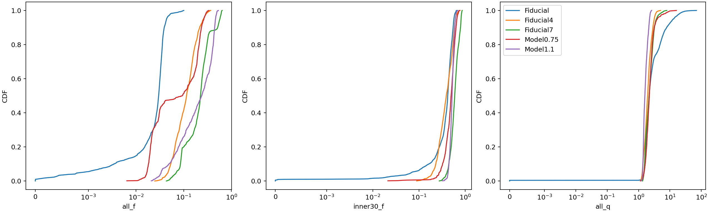

# 冷致密气体比例与 Fiducial7 的闭合不足

日期：2026-11-11。证据类型：本地 fine 气体场、权威体积、metadata/UID、实际 train 清单、正式模型预测、描述性代数分解。没有重新训练模型，没有进行物理因果干预。

## 结论

数据支持把冷致密气体比例作为 Fiducial7 闭合不足的重要解释，但不支持把持续低估简单归结为该比例超出训练集最大值。

- Fiducial7 的全域和内 30 kpc 冷致密质量比例分别只有 8.37% 和 12.65% 的帧超出实际训练范围。范围内仍有明显低估。
- 相对于输入相近、baseline 相近的真实训练帧，Fiducial7 的冷致密质量比例却系统性偏高：3518 个较近配对中，内 30 kpc 比例有 93.06% 高于参考。
- 在这些较近配对中，内 30 kpc 的比例项占自由落体近似 SFR 净差额的 68.15%，总气体质量项占 22.24%，成星气体密度矩项占 9.61%。这支持条件于相近粗场的未解析成星气体含量差异，而不是单独的全局密度范围外推。
- 68.15% 是固定配对下所需 SFR 差额的代数分解，不是已经证明的模型误差因果贡献率。输入相近不等于输入相同，模型是否充分利用现有输入仍未排除。

## 1. 定义与数据

使用五个星系共 26132 个独立 parent HR 帧。Fiducial、Fiducial4、Fiducial7 分别为 8429、8770、7025 帧，Model0.75、Model1.1 各 954 帧。它们是现有正式 cache 所覆盖的帧，不等于无缺帧完整原始模拟。

按现有二维算子判断成星条件：

\[
I_{cd}=\mathbf 1[T<4\times10^4\ {\rm K}]\mathbf 1[1.02\rho>1],\qquad T=93e/\rho.
\]

这里 rho 是代码质量密度。统计质量比例而非格子数比例：

\[
M_{cd}=\sum_i\rho_i V_i I_{cd,i},\quad f_{cd}=M_{cd}/M_g,\quad
q=\frac{\sum_i\rho_i^{3/2}V_iI_{cd,i}}{M_{cd}},\quad
S_{ff}=K M_g f_{cd}q.
\]

其中 K=0.025×0.01×sqrt(32×112.3/(3π))，M 使用代码质量，Sff 为 Msun/yr。q 为成星气体的质量加权 sqrt(rho)，不能用总体平均密度替代。Mcd=0 时 q=0 只是代数约定。

既报告全域，也报告 r<30 kpc；全域比例的分母包含外部非成星气体，不能直接作为盘内成星气体比例。旧 SFR_zero_stats notebook 的零 SFR 格子数量统计不能替代这里的质量统计。

真值 Y 仍使用保守归约的 Data-Set-11 总量。fine 文件没有保存原始逐 HR 格点真实 SFR，因此上述重建仅为物理诊断。Fiducial7 的 |Sff−Y|/Y 的第 99 百分位仅 0.141%，支持在该星系使用自由落体近似。Fiducial 的对应值为 59.23%，低 SFR 帧存在例外，不能把该近似宣布为所有帧均精确。其他三组分别为 Fiducial4 0.908%、Model0.75 0.025%、Model1.1 0.018%。

## 2. 各星系冷致密气体

以下均为逐 snapshot 指标的中位数，非时间积分、非中位数的乘积。

|星系|全域 fcd|内 30 kpc fcd|全域 Mcd（10^9 Msun）|全域 q（代码密度平方根）|
|---|---:|---:|---:|---:|
|Fiducial|2.98%|42.02%|2.251|2.178|
|Fiducial4|11.43%|39.11%|22.899|1.942|
|Fiducial7|22.42%|59.49%|34.343|2.160|
|Model0.75|9.30%|49.74%|15.003|2.210|
|Model1.1|23.83%|52.17%|2.607|1.589|

Fiducial7 的盘内质量比例和绝对冷致密质量均偏高，密度矩并不异常高。Model1.1 的全域比例甚至高于 Fiducial7，但冷致密质量小得多，说明不能只凭 fcd 排列 SFR 或闭合幅度。

## 3. 每折的真实训练覆盖

训练范围只由该折实际 train 的去重 UID 估计，不使用 val/test/out 拟合。严格范围外指低于 train min 或高于 train max；它不是多维联合分布的域外判据。

|留出星系|全域比例的训练范围|全域范围外帧|内 30 kpc 比例的训练范围|内 30 kpc 范围外帧|
|---|---|---:|---|---:|
|Fiducial|0.64%–63.85%|12.81%，低端|2.13%–86.41%|2.37%，低端|
|Model0.75|0–63.71%|0|0–86.21%|0|
|Fiducial7|0–53.10%|8.37%，高端|0–77.47%|12.65%，高端|

Fiducial7 的全域比例中位数为 22.42%，该折训练中位数为 5.19%；内 30 kpc 则是 59.49% 对 42.40%。落在训练 p01–p99 之外的比例分别为 11.80% 和 27.62%，反映分布偏移，但不能将中心区间外全部称为严格域外。Fiducial7 的 q 全部在训练 min/max 和 p01–p99 内。

按冷致密比例范围对 Fiducial7 正式 out 预测分层：

|口径与分组|N|平均预测偏差（Msun/yr）|中位逐帧相对误差|
|---|---:|---:|---:|
|全域 fcd 范围内|6437|−5.148|−34.13%|
|全域 fcd 范围外|588|−21.914|−36.99%|
|内 30 kpc fcd 范围内|6136|−6.097|−35.80%|
|内 30 kpc fcd 范围外|889|−9.688|−20.36%|

偏差定义为 Yhat−Y=Chat−C。不同分层的 SFR 构成不同，绝对偏差不能直接作为因果效应比较。盘内比例范围外帧的相对误差甚至较小，进一步反对“越超范围就必然越难预测”的简单解释。

该折高 SFR 域外帧（Y>实际 train Ymax）共 532 帧，其中 455 帧全域 fcd 超范围、274 帧盘内 fcd 超范围。但高 SFR 子集中，比例范围内与范围外的中位相对误差都约 −38%：全域为 −38.15% 对 −37.81%，盘内为 −37.89% 对 −38.26%。比例越界与部分高 SFR 爆发共现，但不能单独解释低估。

## 4. 与输入相近的训练帧比较

沿用上一闭合报告的 b10 配对：用全 12 通道、12×20 粗输入的 RMS 距离寻找实际训练帧，并要求 |B−Bref|≤max(0.25,0.1|B|)，单位 Msun/yr；排除同运行时间差小于 0.25 Gyr 的参考候选。选择过程不使用本次 HR 冷致密指标。close 子集要求已保存距离≤0.5；该数值沿用原输入距离定义，不是物理距离或概率。完整匹配和 close 的结果均见 paired_decomposition.csv。

Fiducial 使用原始 UNet42，Model0.75 和 Fiducial7 使用用户指定的 Final UNet；未将不同 Fiducial ReLU 版本的误差混合。test 表示已参与训练的星系中独立保留的测试帧，不是训练帧预测，也不是严格时间外推。

### Fiducial7 较近配对

共 3518 对，均为训练 SFR 范围内的留出帧：

|指标|Fiducial7|配对训练参考|
|---|---:|---:|
|全域 fcd 中位数|20.57%|8.10%|
|内 30 kpc fcd 中位数|57.09%|37.50%|
|内 30 kpc q 中位数|1.917|1.828|

全域 fcd 有 99.74% 的配对高于参考，盘内为 93.06%。这比单独比较全局中位数更直接地揭示条件差异，但并未证明所有输入维度都被严格匹配。

三因子乘积采用对称 Shapley 代数分解，不依赖替换因素的先后顺序。每帧先分解再求平均，不能用上表中位数之差代替。

|内 30 kpc 的 Sff 差额贡献|平均贡献（Msun/yr）|占净 Sff 差额|
|---|---:|---:|
|气体总质量 M|+1.117|22.24%|
|冷致密质量比例 fcd|+3.424|68.15%|
|成星气体密度矩 q|+0.483|9.61%|
|合计|+5.024|100%|

真实 Y−Yref 平均为 +5.051，与盘内 Sff 差额仅差 +0.027；B−Bref 为 +0.045，所以实际所需 C−Cref=+5.006。模型却只有 Chat−Cref=+0.914，留下 Chat−C=−4.093。这里 +0.914/+5.006≈18.25% 是均值之比，不是逐帧修正比的中位数。

全域分解对应质量 −2.072、比例 +6.632、密度矩 +0.491；合计 +5.051。比例项仍然主导，但数值超过净差额，因为质量项抵消了一部分。因此“比例贡献百分比”依赖物理区域定义，不应将 68% 当成唯一不变常数。

全部 6889 个有效配对的盘内分解为质量 +3.747、比例 +4.359、密度矩 −0.813；所需闭合差 +7.168，模型偏差 −6.297。冷致密比例项仍是最大的正项，但质量项也重要，close 子集并不代表全部爆发帧。

### 与另两折和已知星系测试比较

|留出折，close 子集|N|盘内 fcd / 参考中位数|平均 C−Cref|平均 Chat−C|
|---|---:|---|---:|---:|
|Fiducial|4045|44.44% / 54.57%|−0.032|+0.050|
|Model0.75|374|54.93% / 52.54%|+0.472|+0.060|
|Fiducial7|3518|57.09% / 37.50%|+5.006|−4.093|

Model0.75 的较近配对盘内比例没有类似持续向上偏移（51.87% 高于参考），且所需闭合差小得多。其全部 954 个配对的净差额主要来自密度矩项，而 close 子集主要来自质量项；这表明不能把该折所有阶段归于同一个机制。

Fiducial7 这折的已知星系 test 较近配对共 2653 对，盘内 fcd 中位数 44.36% 对参考 45.06%，仅 46.97% 高于参考，平均模型偏差 +0.018。没有留出 Fiducial7 那样系统性的比例偏移和低估。该对照有助于排除所有运行一概失准的解释，但不构成独立时间外推证据。

另外，“相对 baseline 闭合为正”和“相对训练参考 Cref 继续上调”是两件事。Fiducial 多数 C 为正，但此处相对训练参考的平均闭合差接近零或为负，不能把两种上调混用。

## 5. 物理解读与不能排除的解释

1. 自由落体主导意味着连续近似下 SFR 取决于冷致密气体的质量及其 rho^(1/2) 质量加权矩。粗 rho 场或若干气体统计量的覆盖不等于 HR 的 rho–T 联合分布和阈值占有率都已被覆盖。此前的“88% 覆盖”不能直接推导出 HR 密度尾部无需泛化。本次直接测得 q 并不异常，才提供了更针对性的证据。
2. 相同或相近粗平均 rho/e 可由不同冷热相混合产生；平均后的温度和密度是否过阈值，不能确定块内到底有多少质量满足阈值。Fiducial7 的近邻结果符合这种未解析结构差异：训练参考的盘内冷致密质量比例偏低，若预测沿用这种关系，闭合就会不足。
3. HR 冷致密质量落在 LR 不满足条件的粗块中的比例，其中位数依次为 Fiducial 82.14%、Fiducial4 55.99%、Fiducial7 65.47%、Model0.75 70.53%、Model1.1 95.47%。因此“粗化隐藏冷气体”普遍存在，Fiducial7 并非最大；它本身不足以区分哪个模型会失败。更关键的是粗输入与 HR 冷致密质量之间的关系能否从训练运行迁移。
4. 本分析尚不能确定该条件偏移来自黑洞质量的哪条具体因果链，也不能排除模型容量、损失权重、训练样本支持度或输入编码导致模型未利用现有信息。没有进行黑洞质量受控干预，也没有证明 coarse 输入下 HR 结构不可辨识。
5. 下一步最有区分力的验证是：以 HR fcd 或 Mcd 作为仅诊断用辅助监督，检查从现有粗输入预测它的 leave-one-galaxy-out 误差；若同样在 Fiducial7 上系统性低估，则物理中介假设得到更直接支持。再用 oracle HR 量的独立对照测定可消除的误差上限。HR 量不能直接混入当前正式模型输入，也不能把 oracle 改进当作可部署性能。

## 6. 验证与文件

- 15 帧 smoke：五组各 3 帧，通过。
- 全量 26132 帧：parent/time/Y 一致、正体积、有限气体值、12×20 块质量守恒、乘积恒等式，通过。
- train 身份完整连接、正式预测 Y/time 核验、三折 train.pt SHA256 与上一报告一致、配对三项之和等于 Sff 差，通过。
- `python -m unittest tests.test_cold_dense_closure -q`：4 项测试通过，覆盖质量比例与格子比例区别、密度矩非线性、零成星条件和对称代数分解。
- 本报告不提供帧独立假设下的显著性 p 值；时间相邻帧相关。未做本次统计的时间块置信区间、多种近邻度量敏感性或新训练消融。
- 复现入口为 `VisualScripts/DataAnalysis/analyze_cold_dense_closure.py`，参数说明见同名 `.md`。精确结果见 galaxy_summary.csv、fold_coverage.csv、errors_by_fraction.csv、paired_decomposition.csv、ff_validation.csv；来源与哈希见 method.json。逐帧 parquet 和 pairs.csv.gz 仅本地保存。
