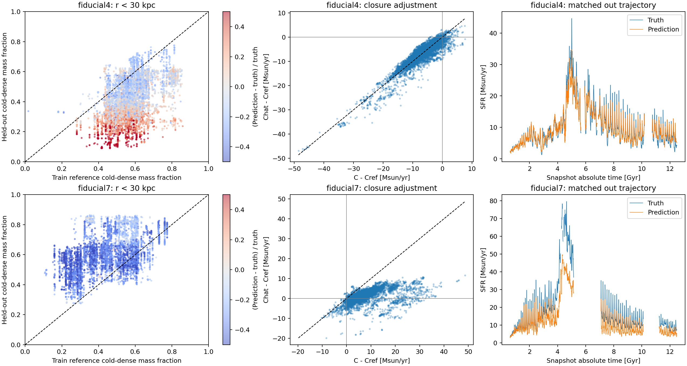

# 留出 Fiducial4：预测性能、闭合修正与冷致密气体诊断

日期：2026-11-11。证据来自正式预测、cache/metadata、UID与SHA256核验、此前逐帧HR气体统计和训练近邻。未重新训练或推理，没有物理因果干预。

## 核心判断

Fiducial4 提供了与 Fiducial7 方向相反的有用对照：在相近粗输入和baseline下，它的盘内冷致密气体比例通常更低，所需闭合也更小，模型大体完成了相对训练参考的下调。冷致密比例差异仍是所需SFR差额的最大项。

这进一步支持“检查粗输入与HR成星气体含量之间的关系”，但同时收窄了因果结论：明显的条件差异并不必然导致预测失败；Fiducial4能下调成功，Fiducial7则上调不足。Fiducial4少数上调失败帧的正差额主要涉及质量或密度矩，不能归结为冷致密比例单项。

因此，目前证据支持冷致密比例是关键物理解释量；尚不能说它是模型泛化误差的唯一主因，也不能说比例越界是必要条件。

## 1. 实验与核验

结果目录：`Results/Exp2_LOO_Fiducial4_SFRUNet_ReLU_Candidate1_Final_20261111_175216_a6a6b5c3`。

- summary为complete、非HPO，100个epoch，best_epoch=99；配置seed=42、ReLU Candidate1。
- 使用该折自己的train/val/test/out、metadata和norm；全部SHA256与训练contract匹配。
- 10416个去重训练帧，3476个已知运行test帧，8770个Fiducial4留出out帧。UID和parent跨split隔离。
- 真实Y/B与正式预测按UID连接；逐格地图和总量、candidate及ReLU、最终有效闭合Chat=P−B均由现有分析入口核验。
- 所有量保留，包括峰值、负闭合与全部预测误差；SFR单位Msun/yr，不再乘体积。
- 已有用户分析目录`analysis_sfr_unet_20261111_182713_92d23b`中的物理指标与本次重算一致。已有Train_history登记未改动。

这里的best_score=0.008157是训练使用的变换域联合指标，不能当成物理空间MAE。下面全部主要性能指标都在物理空间计算。

## 2. Fiducial4整体表现与时序误差

|方法|MAE|RMSE|Bias|R²|中位绝对相对误差|
|---|---:|---:|---:|---:|---:|
|MACER-LR baseline|6.1048|7.1827|−6.1048|−0.2175|60.83%|
|Final UNet|1.4634|2.0495|−0.1576|0.9009|12.45%|

平均真实SFR=10.0707，预测=9.9131，baseline=3.9660。MAE相对baseline下降76.03%。真实闭合均值6.1048，最终预测闭合均值5.9471，均值总和恢复97.42%。这不是逐帧修正率。

按真实时间梯形积分、排除3个大缺口后，覆盖10.96625 Gyr，UNet形成质量误差−1.57%，baseline为−60.62%。积分仅代表cache实际观测区间，不能补全缺失轨迹。

平均偏差很小包含阶段间抵消，不能宣布所有阶段准确：

- 绝对时间4.5–5.0 Gyr平均偏差−3.630，5.0–5.5 Gyr为−3.412。
- 真实SFR最大帧位于5.0075 Gyr，Y=44.660、预测34.477，低估22.80%；该帧C=21.186，Chat=11.003。
- 后期多个时间段偏高，例如12.0–12.5 Gyr平均偏差+1.645，中位逐帧相对误差+33.76%。
- 固定0.5 Gyr分箱仅用于描述，不把这些边界直接认定为物理吸积事件。

0.25/0.5 Gyr时间块bootstrap中，整体Bias区间分别为[−0.586,+0.219]、[−0.707,+0.303]。它们不包含训练种子或不同模拟运行的不确定性。

## 3. SFR与粗场覆盖

该折实际训练SFR范围为0–84.0887；Fiducial4最大44.6601，全部8770帧均在该范围内。不存在可以用于估计高/低SFR严格范围外性能的留出帧，不能据本实验声称SFR范围外泛化已验证。

按既有train-only校准的p95近邻距离代理：

|粗输入口径|覆盖比例|
|---|---:|
|全场12通道|92.45%|
|内盘12通道|96.50%|
|内30 kpc热力学通道|80.83%|

这些比例依赖表示、空间窗口和距离标尺，不是严格高维物理支持集的概率。

全场覆盖内8108帧：UNet MAE=1.322、Bias=+0.050；覆盖外662帧：MAE=3.197、Bias=−2.699。覆盖外绝对误差更大，同时其SFR分布也不同，不能仅归因于是否越界。两组都优于baseline。

## 4. 冷致密比例与条件于近邻的差异

采用此前完全相同的成星阈值T<4e4 K、1.02rho>1，按权威体积计算质量。自由落体近似：

\[
S_{ff}=K M_g f_{cd}q,\quad q=\langle\sqrt{\rho}\rangle_{M,cd}.
\]

Fiducial4的重建Sff相对真实总Y的绝对相对误差第99百分位0.908%；标签仍为Data-Set-11保守归约量，Sff仅作诊断。

Fiducial4全域fcd中位数11.43%，内30 kpc为39.11%，Mcd中位数2.290e10 Msun。它们来自已有8770帧HR统计，不是新模型预测。该折全部帧的全域与盘内fcd均落在实际train min/max及p01–p99内。密度矩q中位数1.942，也全部在训练min/max内。

但实际训练总体中位数不足以代表相近输入的参考：

|b10配对口径|N|Fiducial4盘内fcd中位数|参考中位数|留出fcd高于参考的比例|
|---|---:|---:|---:|---:|
|全部有效配对|8770|39.11%|57.10%|9.05%|
|输入距离≤0.5|2848|43.88%|56.54%|8.15%|

b10只从实际train选取，要求|B−Bref|≤max(0.25,0.1|B|)，输入距离按原方法计算；参考选择不用查询Y/C或HR物理量。同运行±0.25 Gyr内帧排除。Fiducial4全部配对有8750/8770参考来自Fiducial7，不能将它描述为均匀混合的训练参考。

相近输入不等于相同输入；Fiducial4最小b10距离约0.263，median0.549。因此这是指定度量下的条件差异证据，不是已证明同一X对应两个不同Y。

## 5. 与Fiducial7的方向对照

定义Delta=C−Cref，R=Chat−Cref；R−Delta即预测误差。以下先逐帧计算，再求平均，单位Msun/yr。

|留出折/较近配对|N|平均Delta|平均R|平均误差|alpha逐帧中位数|
|---|---:|---:|---:|---:|---:|
|Fiducial|4045|−0.032|+0.018|+0.050|0.893|
|Model0.75|374|+0.472|+0.532|+0.060|1.011|
|Fiducial4|2848|−4.014|−3.778|+0.237|0.936|
|Fiducial7|3518|+5.006|+0.914|−4.093|0.197|

alpha=R/Delta，只统计|Delta|超过各折由train决定的门槛；它是描述量，不是因果系数。Fiducial使用原始UNet42，其余为指定Final UNet，各折优化配置并不完全相同。

Fiducial4全部配对的alpha中位数0.949；b05/b20分别0.953/0.949，五近邻Cref中位数替代单近邻后为0.951，主要方向稳定。

较近配对的内30 kpc三因子对称代数分解：

|因素|Fiducial4 Sff差额贡献|Fiducial7 Sff差额贡献|
|---|---:|---:|
|总气体质量M|−0.086|+1.117|
|冷致密质量比例fcd|−2.827|+3.424|
|成星气体密度矩q|−1.125|+0.483|
|合计|−4.039|+5.024|

Fiducial4所需SFR下降中，比例项约70.00%，密度矩27.86%，质量2.14%。与真实Y差额−4.039几乎一致。Fiducial7对应比例项68.15%。这些是固定配对、固定孔径的所需SFR差额分解，不能当成模型误差的因果解释率。

物理含义：Fiducial4相对于其近邻需要减少成星气体占有率，模型能够完成大部分下调；Fiducial7相对于其近邻需要增加占有率，模型未补足。明显的近邻条件偏移本身并不足以断言必然预测失败，方向、输入可识别信号和训练支持仍须考虑。



## 6. 对“冷致密比例是主要原因”的补充约束

Fiducial4不是所有帧都成功。按该折train决定的稳定门槛，8287帧需要相对参考下调，400帧需要上调，剩余83帧差额较小。

|Fiducial4全部匹配分层|N|平均Delta|平均R|平均误差|alpha中位数|
|---|---:|---:|---:|---:|---:|
|需要下调|8287|−6.571|−6.600|−0.029|0.960|
|需要上调|400|+1.588|−1.005|−2.594|−0.642|

上调失败在较近子集中也存在：123帧，所需Delta=+0.882、预测R=−0.117、误差−0.999。它不是仅由很远的参考造成。

但400个上调帧的盘内Sff差额分解为：质量+3.948、比例−0.539、密度矩−1.729。它们所需净上调主要由质量项推动，**不是冷致密比例更高主导**。这说明“闭合上调失败”可以有不同物理来源，不能把所有上调不足都解释为fcd。

按盘内fcd与参考的差值进行固定±5个百分点分层：

|Fiducial4分层|N|平均预测偏差|中位相对误差|
|---|---:|---:|---:|
|比参考低超过5个百分点|7232|+0.248|+5.08%|
|相差不超过5个百分点|1243|−1.917|−12.09%|
|比参考高超过5个百分点|295|−2.677|−15.55%|

该关联与冷致密气体偏多时更容易低估相符，但各组质量、密度矩、时间和SFR构成也不同。295帧的平均真实Delta仍为负，密度矩项有显著抵消，不能把fcd高直接等同于所需闭合更高。

## 7. 同一批帧，留出与纳入训练后的对照

以UID严格配对，Y/B/time及parent完全核验。known是该星系部分帧参与训练后，仍独立保留的test，不是训练帧误差。

|同一星系/同一批测试帧|N|该星系留出时MAE|该星系纳入训练后的test MAE|
|---|---:|---:|---:|
|Fiducial7|1405|6.761|0.433|
|Fiducial4|1754|1.431|0.186|

Fiducial7对应Bias从−6.739变为+0.192。这个对照支持跨运行泛化失效，而不是Fiducial7标签或该系列网络对其一概不可拟合。但两次模型的训练集、归一化和优化配置均变化，test与train也可能时间相邻；不能当成严格控制其他因素、只加入某个物理参数的消融。

## 8. 研究解释与下一步

1. 得到加强的结论：粗场覆盖与HR成星气体含量覆盖不同；冷致密质量比例是解释相近粗场下真实SFR/闭合差异的关键量。Fiducial4的反向结果提供了补充证据。
2. 需要收窄的结论：fcd条件差异不是预测失败的充分条件。模型在Fiducial4能够大幅下调，Fiducial7却未完成上调；Fiducial4上调失败还有质量驱动的例子。因此需要同时研究M、fcd、q，以及模型是否利用了相应粗场信号。
3. 参数方向内插/端点泛化是可检验的解释：留出Fiducial4时训练含Fiducial与Fiducial7；留出Fiducial7时只有Fiducial与Fiducial4等参考。这与前者较容易泛化相容，但不能仅凭排序证明机制。
4. 不能将上述对照称为仅黑洞质量变化的单参数因果实验。当前README的本地核验还指出Fiducial4/7初始dstar和Mstar_i也分别是Fiducial的4/7倍；其余未核验开关亦未闭合。黑洞反馈、引力势、恒星物质回流等具体因果链尚不能由本次统计分离。
5. 下一步优先用现有粗输入独立预测Mcd/fcd与q，做相同LOO对照，并检查预测偏差是否同步出现。HR量只作辅助监督或oracle诊断，不直接混入当前正式推理输入。若预测fcd本身不低估而SFR仍低估，需转向密度矩、空间分配、损失/容量等解释。

## 9. 复现与验证

使用`D:/conda_envs/physics_ai/python.exe`：

```powershell
python VisualScripts/ResultAnalysis/compare_fiducial_domains.py --case fiducial4 --output-dir VisualScripts/ResultAnalysis/outputs/fiducial4_domains_20261111 --bootstrap-repeats 2000
python VisualScripts/ResultAnalysis/compare_closure_reference.py --cases fiducial4 --output-dir VisualScripts/ResultAnalysis/outputs/fiducial4_closure_20261111
python VisualScripts/DataAnalysis/analyze_cold_dense_closure.py --cases fiducial4 --reference-dir VisualScripts/ResultAnalysis/outputs/fiducial4_closure_20261111 --moments-dir VisualScripts/DataAnalysis/outputs/cold_dense_closure_20261111 --output-dir VisualScripts/DataAnalysis/outputs/fiducial4_cold_dense_20261111
python VisualScripts/DataAnalysis/compare_cold_dense_folds.py --output-dir VisualScripts/DataAnalysis/outputs/cold_dense_four_folds_20261111_final
python -m unittest tests.test_closure_reference tests.test_fiducial_domains tests.test_cold_dense_closure tests.test_analyze_sfr_unet tests.test_cold_dense_fold_comparison -q
```

输出目录均拒绝覆盖；复现时改成新的目录。cold-dense入口在首次运行后修正了相对路径的来源哈希序列化，并已以相同数据完整重算成功。四折入口已完整执行；同UID角色对照新增独立单元验证。上列23项测试全部通过。

复用已核验的26132帧物理矩，不重复扫描fine；本次检查新折的训练完整连接、预测Y/time、train摘要、三项代数恒等式。没有把原始HR重建SFR替代真值。未做新训练、多随机种子、四折fcd分解的块置信区间或更多配对度量敏感性。

本目录conditional_metrics.csv、time_metrics.csv、reference_groups.csv、same_frames_roles.csv为四折补充统计，method.json记录来源和哈希。新折的分布覆盖、预测性能和原始闭合关系分别在同级任务输出目录保存；逐帧大文件仅本地保留。
