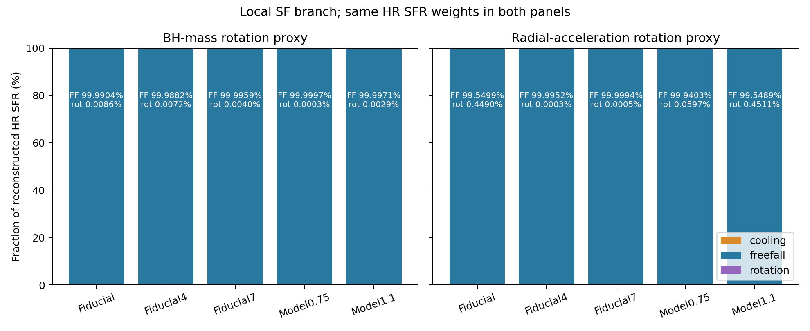
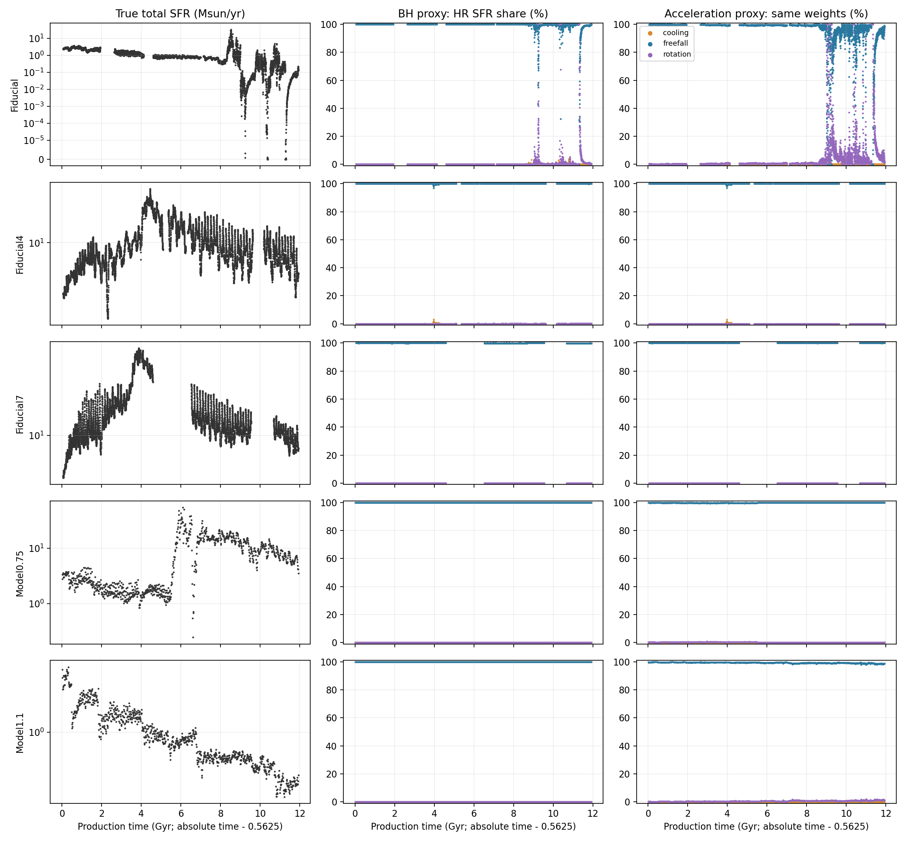
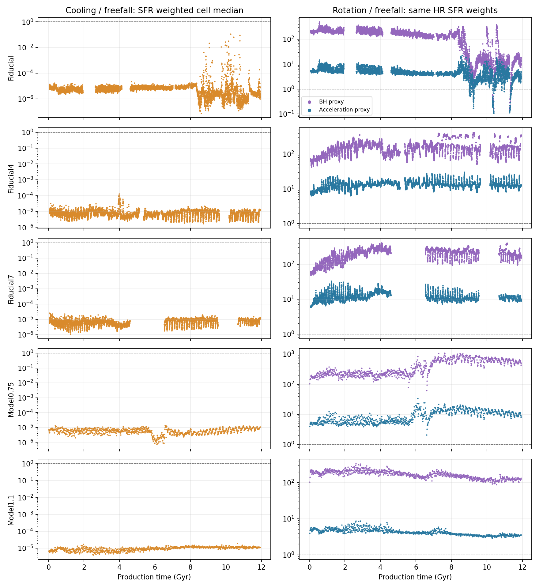

# 五组盘星系的恒星形成时标诊断（2026-11-11）

## 结论及证据范围

**按项目当前已复现的二维成星处方，五组盘星系的局部成星总体由自由落体分支主导。**
冷却通常很快，旋转分支只贡献较小比例；Fiducial 晚期存在旋转分支占优的低 SFR 快照。
这是源码、metadata 和现有气体场支持的处方诊断，不是整星系淬火或供气机制的因果证明。

检索找到了已有 [sSFR 分析](../../plot_disk_ssfr_evolution.md) 和
`data/macer_sfr_multisnapshot_validation.csv` 中的算子复现记录，但未找到五组星系的完整三时标分支占比分析；本报告为补做结果。

## 1. 判据

现有 `isf=2` 算子使用：

\[
\tau_\star=\max\left[\tau_{\rm cool},\min(\tau_{\rm ff},\tau_{\rm rot})\right],\qquad
\tau_{\rm ff}=\sqrt{\frac{3\pi}{32G\rho}}.
\]

成星阈值为 `T<4e4 K`、`1.02*rho>1`。先选自由落体和旋转中较短者，再判断冷却是否更慢；
不能把三个时标直接取最大值或最小值，也不能用全域热 CGM 的平均冷却时间代替成星区域的诊断。

## 2. 全量可用产品的分支贡献

共 26,132 帧，逐帧核验 HR baseline、真实标量 SFR、真实粗块标签、来源 UID 和权威体积。
主表按保存的 **重建 HR SFR** 及已覆盖物理时间积分；不是按 snapshot 数量投票。

| 运行 | 帧数 | 自由落体 % | 旋转 % | 冷却 % | 阈值内气体质量×时间的自由落体占比 % |
| --- | --- | --- | --- | --- | --- |
| Fiducial | 8429 | 99.990359 | 0.008557 | 0.001084 | 99.8881 |
| Fiducial4 | 8770 | 99.988225 | 0.007189 | 0.004585 | 99.8446 |
| Fiducial7 | 7025 | 99.995949 | 0.004040 | 0.000011 | 99.9930 |
| Model0.75 | 954 | 99.999679 | 0.000321 | 0.000000 | 99.9997 |
| Model1.1 | 954 | 99.997109 | 0.002891 | 0.000001 | 99.9977 |



主权重来自 `data_compatible/cell_sfr_baseline`。现有 fine 没有保存 HR 逐格 Data-Set-11，
原始 E: 数据盘本次不可访问，因此这些精细占比不能称为直接测得的真实 HR SFR 分解。
真实标量及逐块标签来自已保存的 Data-Set-11 保守归约；SFR 换算为 `0.025 Msun/yr` 每代码单位，未再乘体积。

## 3. 旋转定义的敏感性与局部例外

数据兼容模式：`tau_rot=2*pi*sqrt(r^3/(G*M_BH))`，这是已有 enclosed-mass 近似。
物理对照模式：`tau_rot=2*pi*sqrt(r/abs(a_r))`。
两者均为现有算子的引力时标代理，不是由 `v_phi` 直接测量的实际气体公转周期。
共同权重列只改变分支划分；自身权重列使用对应模式重算的 SFR（两模式的 `cstar` 也不同）。

| 运行 | 加速度定义：自由落体 %（共同权重） | 加速度定义：自由落体 %（自身权重） | 旋转占优帧：BH / 加速度 |
| --- | --- | --- | --- |
| Fiducial | 99.54985 | 99.38707 | 71 / 191 |
| Fiducial4 | 99.99515 | 99.99533 | 0 / 0 |
| Fiducial7 | 99.99945 | 99.99970 | 0 / 0 |
| Model0.75 | 99.94030 | 99.91919 | 0 / 0 |
| Model1.1 | 99.54890 | 99.38273 | 0 / 0 |

Fiducial 的数据兼容模式有 71 帧旋转贡献超过一半，
但这些帧仅贡献覆盖区间真实 SFR 积分的 0.000074%。
因此“全程总体主导”与“个别低 SFR 帧的局部分支”需要区分。
分阶段统计见 `phase_summary.csv`，具体例子见 `rotation_examples.csv`。



## 4. 时标的典型大小

以下每个数先在各帧内部对 HR 单元按重建 SFR 求中位数，再对非零 SFR 帧的中位数求中位数。
它们不是全程合并样本的分位数，也不是三个平均值的比值。

| 运行 | 自由落体 Myr | 冷却 yr | 冷却/自由落体 | BH 旋转/自由落体 | 加速度旋转/自由落体 |
| --- | --- | --- | --- | --- | --- |
| Fiducial | 18.757 | 120.96 | 6.28e-06 | 157.670 | 4.430 |
| Fiducial4 | 23.023 | 179.52 | 7.68e-06 | 151.875 | 13.181 |
| Fiducial7 | 20.364 | 148.12 | 7.33e-06 | 213.604 | 10.836 |
| Model0.75 | 18.512 | 112.13 | 6.04e-06 | 296.963 | 8.510 |
| Model1.1 | 30.923 | 313.90 | 1.01e-05 | 170.505 | 4.211 |

冷却通常比自由落体快约五个数量级。旋转代理通常更长，因而 `min(tau_ff,tau_rot)` 选中自由落体。
这里的 `tau_star` 不是耗尽时间；连续极限的局部气体耗尽时间约为 `tau_star/cstar`，数据兼容模式 `cstar=0.01`。



## 5. 误差、缺帧与真实标签的严格边界

| 运行 | 绝对时间 Gyr | 覆盖时长 Gyr / 覆盖率 | 总 SFR 误差中位数 % | 总 SFR 积分偏差 % | 逐块 L1 积分误差 % |
| --- | --- | --- | --- | --- | --- |
| Fiducial | 0.62–12.4875 | 10.52125 / 88.66% | 0.00462 | -0.00519 | 0.03039 |
| Fiducial4 | 0.62–12.4875 | 10.94875 / 92.26% | 0.00451 | -0.00378 | 0.00898 |
| Fiducial7 | 0.62–12.4875 | 8.77000 / 73.90% | 0.00442 | -0.00421 | 0.00661 |
| Model0.75 | 0.575–12.4875 | 11.91250 / 100.00% | 0.00441 | -0.00242 | 0.00779 |
| Model1.1 | 0.575–12.4875 | 11.91250 / 100.00% | 0.00441 | -0.00391 | 0.00746 |

三组 Fiducial 使用修正时间的 `fine_sfr_v7`；两组 Model 使用时间映射未受 restart 问题影响的 `fine_sfr_v6`。
均沿用现有产品去掉最初 46 个输出后的清单。绘图的 production time 为绝对时间减 `0.5625 Gyr`。
只对相邻间隔不超过 1.5 倍名义 cadence 的帧做梯形积分，不跨缺帧插值。
覆盖率的分母为各运行首末可用帧之间的跨度；结果不能约束缺失区间内未观测到的爆发。
零 SFR 帧保留，不人为补时标。每帧来源与 metadata 中已有的原始 SHA256 记录在 Parquet；本次没有重新散列原始文件。

仅用真实粗块标签和 HR 分支成员关系、完全不假设块内标签分布，可以得到以下保守上下界。
下界只累加全部 HR 单元都属于该分支的块，上界累加任意 HR 单元属于该分支的块；阈值外的 0 类保留。

| 运行 | 真实自由落体贡献的严格区间 % | 真实旋转贡献的严格区间 % | 真实冷却贡献的严格区间 % |
| --- | --- | --- | --- |
| Fiducial | [2.609, 99.999] | [0.000, 5.462] | [0.000, 1.440] |
| Fiducial4 | [2.248, 99.998] | [0.000, 0.088] | [0.000, 0.826] |
| Fiducial7 | [0.051, 99.999] | [0.000, 0.053] | [0.000, 0.204] |
| Model0.75 | [0.074, 100.000] | [0.000, 0.030] | [0.000, 0.002] |
| Model1.1 | [0.000, 100.000] | [0.000, 0.283] | [0.000, 0.045] |

这些区间较宽，说明真实粗块标签本身不足以精确识别 HR 分支贡献。
总量和逐块重建误差小支持使用重建权重，但不证明逐 HR 格点完全一致。
要得到直接的真实 HR 逐格 SFR 分解，仍需恢复原始 HDF4 或补齐 HR 逐格标签。

## 6. 复现与验收

实现和完整口径见 [脚本文档](../../analyze_disk_sf_timescales.md)。实际使用 `D:/conda_envs/physics_ai/python.exe`：

```powershell
python -m unittest discover -s tests -p test_disk_sf_timescales.py -v
python -m unittest discover -s tests -p test_macer_sfr_operator.py -v
python VisualScripts/DataAnalysis/analyze_disk_sf_timescales.py --output-dir tmp/sf_timescales_smoke_20261111_final --max-snapshots 3
python VisualScripts/DataAnalysis/analyze_disk_sf_timescales.py --output-dir VisualScripts/DataAnalysis/outputs/sf_timescales_20261111
python VisualScripts/DataAnalysis/analyze_disk_sf_timescales.py --output-dir VisualScripts/DataAnalysis/outputs/sf_timescales_20261111 --reuse-snapshots
```

6 项统计测试、10 项现有算子测试、五组各 3 帧真实数据 smoke 和全量逐帧一致性核验均已执行。
未修改物理算子、数据、cache 或训练结果，也未启动训练。本结论仅适用于这些二维 Zou 盘星系的现有可用产品，不外推到三维或 GIZMO。
