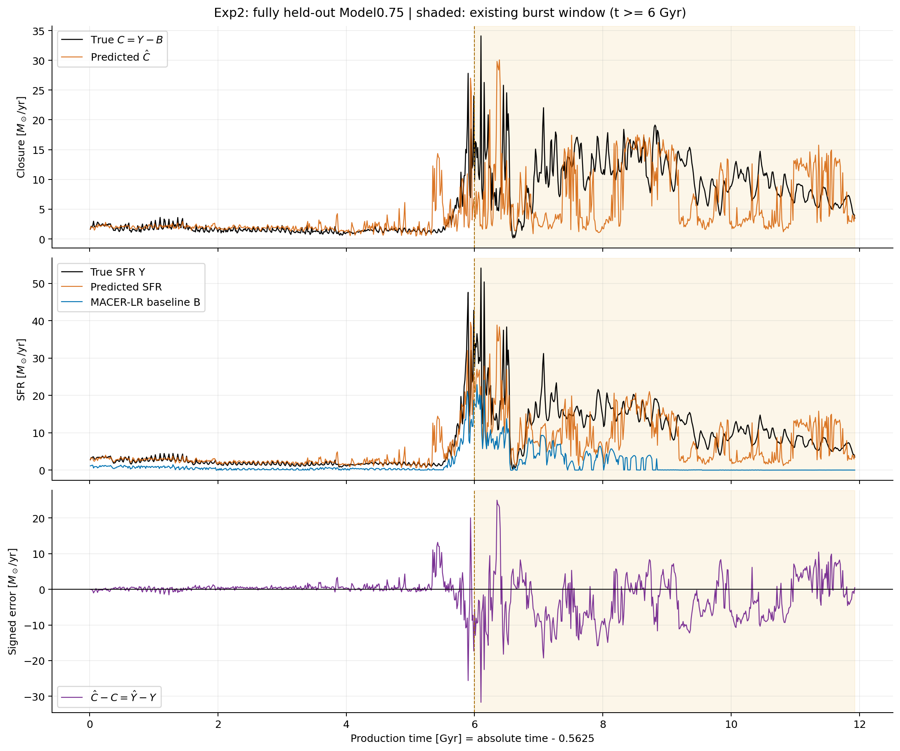
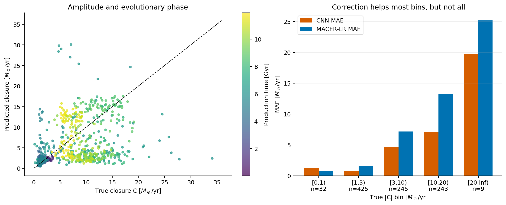
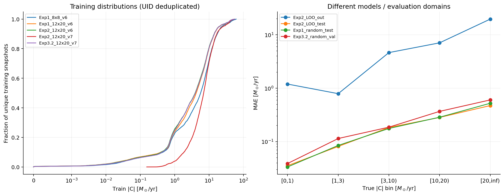

# Exp2 Model0.75 闭合项时间变化与幅值条件误差

分析日期：2026-10-25。主实验：`Exp2_Rh12x20_FiveRuns_Closure_LOO_Model075_Trial53_Final_20260913_004906`。本报告依据本地 checkpoint、cache、metadata、归档预测、已有 burst 分析及项目研究计划；统计关联不作因果解释。

## 1. 主要判断

1. `C=Y-B` 是适合检查闭合学习难点的目标；但这里多数 snapshot 的 C 不是接近零的微小修正。不能直接移植“近零平凡样本占绝大多数”的 SGS 分布假设。
2. Model0.75 的 C 有明显阶段变化和快速波动。留出模型在较大 C 上有明显负偏差，在很小 C 上则可能过度修正；问题不是只遗漏几个最高峰。
3. 在已见运行的随机 test/val 上，大 C 的绝对误差略增，相对误差却很低。跨运行留出后的恶化远大于这种幅值效应。当前证据更支持优先处理跨运行/状态泛化，而不是直接把最极端的 1% 样本重复很多次。
4. 模型显著改善 MACER-LR 的 SFR 低估，但尚未可靠恢复未见运行中闭合项的时间变化。离线收益不能证明在线反馈循环正确。

## 2. 口径、数据与身份核验

所有数值均为物理空间，单位 `Msun/yr`，代码单位乘 0.025。`Yhat=B+Chat`，因此 `Yhat-Y=Chat-C`。分别报告 Y 与 C 的 R²，不能混用二者。

主实验 train 存储 21156 条，按 sample UID 去重后 15187 条；包含 Fiducial、Fiducial4、Fiducial7、Model1.1。`test` 的 5065 条是已见运行随机帧；真正的 leave-one-run/galaxy-out 对象是 `out` 的全部 954 条 Model0.75 帧。目标使用 signed-asinh、closure scale 86.03684（代码单位），不是直接在物理 C 上优化普通 L1。

训练分布采用去重样本，以免已有 oversampling 被误认为自然样本频率。核验 Y=B+C、预测闭合恒等式、有限性、重复样本一致性，以及各 split 的 sample/parent UID 不交叉，均通过。随机帧仍可能与训练帧时间相邻，UID 隔离不能消除此问题。

时间图沿用原始 double 精度 CSV，横轴 `t=t_abs-0.5625 Gyr`。固定采样间隔 0.0125 Gyr。以下“burst 窗口”指原分析的 t≥6 Gyr，不是把其间全部帧都宣称为黑洞吸积爆发。

## 3. C 随时间的变化

上图黑线为真实 C，橙线为预测 Chat；中图给出 Y、预测 Yhat 和 MACER-LR baseline B；下图为预测误差。

| 统计量 | C（Msun/yr） |
|---|---:|
| 最小值 | 0.1533 |
| 中位数 | 4.4556 |
| 90% 分位数 | 13.6926 |
| 99% 分位数 | 19.0569 |
| 最大值 | 34.1025 |

954 帧的 C 全为正。t<6 Gyr 时 C 中位数为 1.5181，t≥6 时为 10.0660，增加约 6.63 倍。相邻两帧最大变化为 25.5899 Msun/yr，发生在 12.5 Myr 的输出间隔内；不能据此还原帧内更短时间尺度。

全历史 C/Y 中位数为 0.8283；t≥6 时达到 0.9944。也就是说，在该阶段的典型帧上，网络需要补出几乎全部 SFR。它承担的是主要预测，而不是在一个已经准确的 baseline 上做小幅校正。

真实 C 峰值发生于 t=6.1000 Gyr，C=34.1025，而同帧 Chat=2.4085，低估约 92.9%。预测自身的 C 最大值是 30.0794，出现在 t=6.3875，较真值峰晚 0.2875 Gyr。Y 的峰时偏差为 0.25 Gyr；两种峰值不能混为一谈。模型逐 snapshot 预测当前 SFR，这里的“晚”是预测曲线的形态错位，不是提前预测未来事件的时延。

较晚阶段还存在反复的虚假低值和局部高估；不能只用“把尖峰平滑掉了”解释整条误差曲线。

## 4. 不同 C 量级的预测效果

这里按真实 |C| 分箱；Model0.75 的 C 全为正。相对误差为 `median(|Chat-C|/|C|)`，bias 为 `mean(Chat-C)`。

| abs(C) 区间 | N | MAE | bias | 相对 C 误差中位数 | 相对 baseline 的 MAE 改善 |
|---|---:|---:|---:|---:|---:|
| [0,1) | 32 | 1.197 | +1.144 | 86.7% | −49.5% |
| [1,3) | 425 | 0.791 | +0.642 | 26.5% | +51.2% |
| [3,10) | 245 | 4.647 | +0.175 | 58.2% | +35.1% |
| [10,20) | 243 | 7.077 | −5.983 | 68.9% | +46.4% |
| ≥20 | 9 | 19.691 | −19.691 | 75.4% | +21.8% |

差异不仅来自大数值自然产生更大的绝对误差：相对误差也在较大 C 区间上升，并出现明显的系统低估。但这不是单调关系，最小 C 区间同样差，且修正比不修正更差。小 C 的相对误差容易放大，故必须同时检查绝对误差和 baseline 改善。

高 C≥10 占 26.4%，并非极罕见尾部。3≤C<20 的帧占 51.2%，贡献约 83.8% 的总绝对误差；C≥20 的九帧只占总绝对误差约 5.2%，但占平方误差约 12.7%。只增强最极端的九帧，不能解决主要误差来源。

用去重训练集分位数重新划分也得到类似结果：训练 C 的中位数、p90、p99 分别为 3.9202、14.0978、41.0815。out 在这些分箱中的 MAE 依次约为 0.828、5.642、8.991；没有 out 帧超过训练 p99。训练最大 C 为 55.7387，高于 out 最大 34.1025。因而不是简单的“测试 C 比训练见过的任何 C 都大”；输入状态及其与 C 的对应关系仍可能处于分布外。

固定时间块 bootstrap 对比 C≥10 和 1≤C<3：0.5 Gyr 块宽下，MAE 差的 95% 重采样区间为 [5.16,8.37]，相对 C 误差中位数之差为 [14.5,51.7] 个百分点，高 C bias 为 [−8.48,−4.33]。0.25/1 Gyr 块宽下方向一致。但这里只是同一条相关时间轨迹的敏感性结果，不是多个独立 burst 的统计置信声明；C 幅值、演化阶段和输入域变化互相混杂。

## 5. 其他 cache 与模型是否支持同样结论

### 5.1 多数 closure 不微小：支持

| 去重训练 cache | 唯一帧数 | median abs(C) | median C/Y |
|---|---:|---:|---:|
| Exp1 8×8 v6 | 14615 | 5.658 | 94.2% |
| Exp1 12×20 v6 | 14615 | 4.214 | 70.9% |
| 当前 Exp2 12×20 v6 | 15187 | 3.920 | 71.9% |
| Exp2 12×20 v7，留出 Fiducial | 10621 | 6.942 | 68.1% |
| Exp3.2 12×20 v7 | 19596 | 3.990 | 72.6% |

在 Y>1e-4 的可比较帧上，满足 |C|<0.1Y 的比例均不超过 0.031%。这不等于每一帧都同等重要，但不支持把绝大多数帧视为“C≈0、只学零就足够”的样本。

这里 v6/v7 是产品/cache 版本简称，不代表 HDF5 format-version 升为 7。各集合的运行组成、分辨率、筛选与契约并不完全一致；同源 snapshot 大量重叠，不能当作五个独立重复实验。Exp2 v7 本次只分析分布，未宣称它有已完成的训练结果。

### 5.2 大 C 必然相对难学：不支持

| 模型/评价域 | 全体 MAE | 1≤abs(C)<3 的相对 C 误差中位数 | 10≤abs(C)<20 的相对 C 误差中位数 |
|---|---:|---:|---:|
| 当前 Exp2：未见 Model0.75 | 3.574 | 26.5% | 68.9% |
| 同一个 Exp2：已见运行随机 test | 0.154 | 2.73% | 1.17% |
| Exp1：随机 test | 0.159 | 2.35% | 1.26% |
| Exp3.2：随机 val，汇总五组 | 0.183 | 3.64% | 1.50% |

同一个 Exp2 checkpoint 的 test 与 out 差别尤其重要：容量固定时，在已见运行里，大 C 的相对误差很小；换成完全未见的运行便恶化。因此“模型根本不能表示大 closure”或“只要 C 大就一定预测差”都不符合观测。

也不能用 Exp3.2 的汇总均值掩盖 Model0.75 的特殊困难：该运行在 Exp3.2 val 的 239 帧 MAE 为 0.827，10≤C<20 的相对误差中位数为 6.80%，但 C≥20 的两帧仍为 47.6%（n=2，证据很弱）。见过该运行后一般高 C 明显改善，最极端峰仍未充分验证。

Exp3.2 val 参与模型选择，不能作为独立最终泛化测试；不同实验的通道、训练产品与超参数也不同，以上不是公平架构消融。Exp1 与 Exp2 随机 test 还共享许多帧。当前不足以确定失败究竟由输入信息不足、训练分布覆盖、变换空间损失还是其他因素主导。

## 6. 已有整体/burst 结果究竟说明什么

| 指标 | 全历史，954 帧 | t≥6 Gyr，475 帧 |
|---|---:|---:|
| CNN MAE | 3.574 | 6.094 |
| MACER-LR MAE | 6.189 | 10.321 |
| 相对 baseline 的 MAE 改善 | 42.2% | 41.0% |
| 物理 Y 的 R² | 0.439 | −0.314 |
| 物理 C 的 R² | −0.088 | −2.174 |
| 积分 SFR 偏差（预测−真值）/真值 | −17.2% | −24.0% |
| baseline 的积分偏差 | −79.3% | −82.1% |
| 绝对误差的时间积分 / ∫Ydt | 45.8% | 48.5% |

**正面证据：**在未见 Model0.75 上，CNN 确实补偿了 baseline 缺失的相当一部分 SFR，尤其把原来约 −82% 的 burst 积分偏差缩小到 −24%。这支持继续研究数据驱动闭合，不应因 R² 为负就宣称它毫无收益。

**不足：**全历史 Y 的 R² 尚为正，而 C 的 R² 已为负；burst 中两者均为负。负 R² 指平方误差超过该评价子集的事后真值均值常数预测，不代表常数是可部署的公平物理模型。它表明“修正 baseline 的平均缺量”和“恢复闭合项变化”是两种不同能力，前者已有证据，后者仍不足。

已有 `metrics_exp2.csv` 中约 0.529 的 R² 属于 log10(1+SFR_code) 空间，不能写成物理 SFR R²。burst 内 CNN 的 Pearson r 约 0.455，baseline 约 0.792；baseline 幅值偏低但时序相关更高，再次说明相关性不能替代幅值与积分误差。

t<6 时积分 SFR 高估约 11.4%，t≥6 时低估约 24.0%。全程 −17.2% 部分掩盖不同时间段误差的抵消。给定真值轨迹上的 SFR 积分也不能预测模型嵌入模拟后最终形成的恒星质量，因为反馈会改变后续输入状态。

### 6.1 对原 burst 时序结论的校正

原定义采用 0.5 Gyr 滑动中位数，阈值为前期中位数的三倍（4.8579 Msun/yr），最短段 0.25 Gyr。这个定义下：真值首段从 5.625 开始，预测从 5.450 开始，早 0.175 Gyr；真值首段一直延伸到资料终点 11.925，预测首段在 9.275 结束。因此“早结束至少 2.65 Gyr”描述的是**首个高状态段**，且真值结尾右删失；模型后来又进入高状态，不是永久熄灭。

原窗口内召回率 71.8%；precision=1 不能解读为完美识别，因为该窗口中平滑后的真值全部为高状态，没有负例。改变平滑宽度 0.25/0.5/1 Gyr 与阈值倍数 2/3/5，召回率约在 49%–95% 间变化，第一段终止时刻也明显变化。这些时刻是操作性定义，不是已确定的物理爆发边界。比较稳健的是持续高 SFR 阶段低估和虚假低状态的问题。

## 7. 对训练与部署的启发

**优先评价三类误差，而不是只按 C 大小决定重要性：**

1. 长时间持续偏差及积分预算：在本例中，持续高 C 阶段贡献主要绝对误差，不能让全程正负抵消掩盖它。
2. 状态转换和恢复：起始、峰值、低落、再增强的幅度/持续时间；需要结合独立的吸积、冷气体和反馈诊断定义事件，不能由 SFR 自己唯一决定物理 burst。
3. 小 C/低 SFR 的过度修正：应检查是否凭空产生额外成星。大 C 上有收益不能抵偿所有低值阶段的物理错误。

这是依据误差与闭合用途提出的研究判断，不是本次已经验证的在线因果效应。总 SFR 标量也不足以确定成星/反馈在 GIZMO/MFM 中的空间分配。

**tail enhancement 可以作为消融，但目前不能认定它是必要或主要解法。** 训练集已有比测试更大的 C；难点集中在未见运行的状态映射。应先在修复契约后的产品上进行多 LOO 折/time-block 验证，并逐运行检查条件误差。若进行重采样，应只用训练集确定阈值，对运行、演化阶段及 C 量级联合分层并限制权重，保留原分布指标；不要依据这个已详细查看的 Model0.75 out 挑最优权重后再把同一 out 称为未触碰的最终测试。

可比较原始训练、温和幅值重权重、运行/阶段均衡几种方案，在相同数据/种子/预算下同时比较物理 MAE、baseline skill、C/Y 的条件误差、积分偏差、低 SFR 误报和跨运行表现。signed-asinh 空间损失会改变大幅值物理误差的相对影响，值得单独消融；本次没有证明它就是高 C 低估的原因。

## 8. 历史契约与验证边界

研究计划第 31.9、33 节记录三个 Fiducial 运行旧 v6 的时间/日志匹配问题。它不只影响横轴，还会通过 mbh/dt 上下文改变 B/C 物理产品；Y 与原始气体数组不因该修复改变。当前主实验早于修复。Model0.75 本身的时间映射无此问题，但其模型的训练目标仍来自旧契约。不能把本报告当作修复后数据流程已被这个 checkpoint 验证，也不能只移动横轴就声称训练问题消除。

单模型/单随机种子、单条留出运行、相关时间采样、历史契约以及二维 filtered-MACER 的域限制均保留。没有三维训练、真实 GIZMO 数据或在线演化证据。当前结果的合理定位是：历史二维产品上的跨运行闭合概念验证，具备明显 baseline 改善，但仍有关键状态误差与迁移问题。

本次没有修改训练、cache、checkpoint、已有分析或 Train_history。新增独立脚本、说明和本目录产物。所有身份/有限值/闭合恒等式断言通过，旧 burst 指标及关键事件定义复现通过；相关 unittest 共 13 项通过。主时间图/阶段表使用归档 CSV，跨模型表使用当前 checkpoint 推理；二者不是逐位相同，最大逐点差异 0.02660 Msun/yr，最大相对差异约 0.199%，全体 MAE 相对差异仅 0.000386%，不改变本报告结论。

复现方式见 `../../analyze_closure_regimes.md`；详细数值见本目录 CSV 与 `audit.json`。三张图同时保留 SVG 版本。
