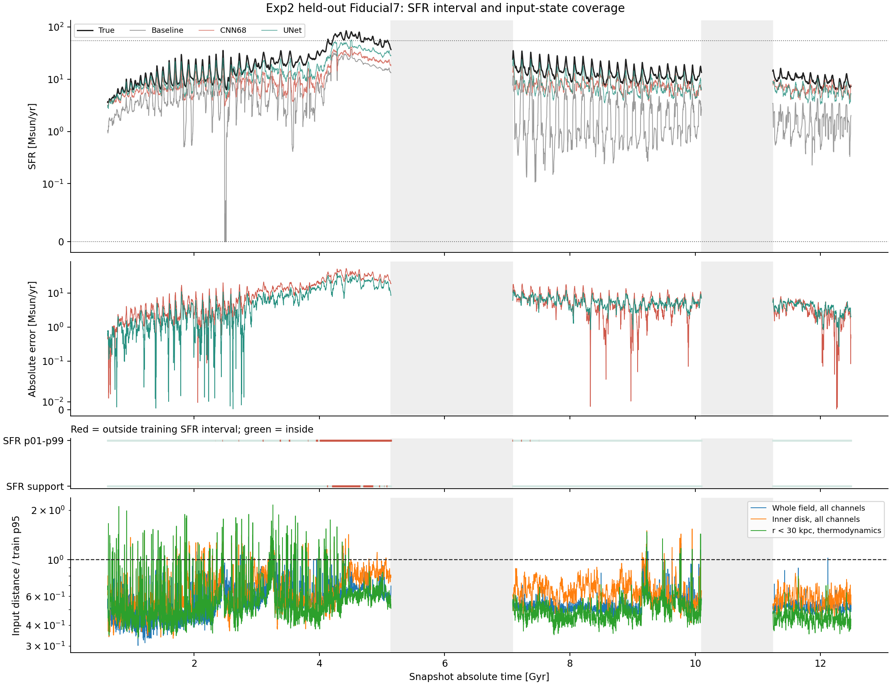
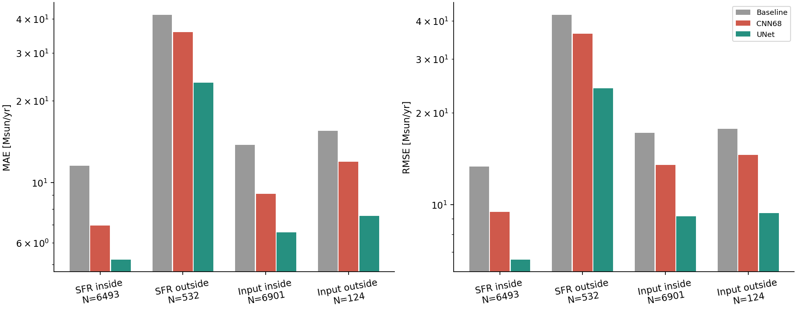

# Fiducial7 Exp2：高 SFR 外推与输入覆盖分层

日期：2026-11-10。证据类型：正式结果、cache/metadata/UID、实际预测与距离计算、测试。
未重新训练或推理，保留全部7025帧；表中为总SFR物理空间MAE/RMSE，单位Msun/yr。

## 结论

UNet在训练标签范围内和高SFR范围外均比CNN Trial68好，但幅值存在持续低估；
高端范围外的MAE仍为23.35，不能称为已解决外推。它与之前Fiducial某些ReLU种子的单帧正尖峰失效不同，
本次主要表现为成段的幅值不足。全场输入距离却将大部分高SFR范围外帧判成覆盖内，暴露该代理指标的局限。

## 数据与对照

UNet：`Exp2_LOO_Fiducial7_SFRUNet_ReLU_Candidate1_Final_20261110_031212_9b4f1351`。
正式complete、hpo=false、seed42、best epoch94/实际100轮、ReLU Candidate1，验证分数0.0136491692。
CNN：已登记正式`Exp2_Rh12x20_Closure_v7_LOO_Fiducial_7_Trial68_seed42_20261026_125202`。
两者同一v7、12×20、12通道metadata和out UID/Y/B；UNet的原train/out/norm SHA256全部与contract一致。
CNN为标量变换空间L1，UNet为逐格物理空间MSE等联合损失，容量/HPO也不同；仍非纯架构消融。

训练Fiducial/Fiducial4/Model0.75/Model1.1，去重train11463帧；out7025帧，绝对时间0.620–12.4875 Gyr。
地图求和、候选/最终输出、B+C_hat、finite与跨split身份均通过；没有裁剪或排除预测。

## 标签范围内与高端范围外

train min–max=0–54.078739；Fiducial7范围=3.527708–84.358398。
范围内6493帧，范围外532帧（7.57%），全部是高端，无低端域外帧。
高端帧出现在4.1325–5.0950 Gyr内的多个观测段；较长连续段为4.21125–4.6650、4.71125–4.8700。
不是整个4.1325–5.0950都越界；更不能根据观测截止或数据缺口认定物理事件已经结束。

|模型|标签范围内 MAE / RMSE|高端范围外 MAE / RMSE|
|---|---:|---:|
|Baseline|11.5425 / 13.3153|41.4507 / 41.8569|
|CNN68|6.9531 / 9.4672|35.8266 / 36.3281|
|UNet|5.2176 / 6.6188|23.3520 / 24.0169|

UNet相对CNN的MAE分别改善25.0%和34.8%；高端组Bias=-23.3520，全部预测都低于对应真值。
高端组的sum(pred)/sum(true)-1=-36.01%（按snapshot求和，非时间积分），
非零真值中位绝对相对误差仍37.95%。范围内也有Bias=-5.1747，因而问题不只存在于越界帧。

将范围改为p01–p99=0.002830–29.886700，域外变为1017帧，
CNN/UNet MAE=30.0810/19.4589；改p05–p95后1871帧，MAE=22.3289/14.2649，改善方向保持。
标签边界改变的是分层定义，不能把这些计数互换。

## 输入场近邻覆盖

与前次一致的train-only方法：每运行最多192时间锚点，每组最多64校准锚点，
校准排除同运行±0.25Gyr近邻；全场12通道RMS p95阈值=0.921884。
覆盖内6901帧（98.23%），覆盖外124帧（1.77%）。

|模型|覆盖内 MAE / RMSE|覆盖外 MAE / RMSE|
|---|---:|---:|
|Baseline|13.7768 / 17.2120|15.5098 / 17.6949|
|CNN68|9.0896 / 13.5007|11.9279 / 14.5413|
|UNet|6.5736 / 9.1704|7.5513 / 9.4008|

覆盖外UNet相对CNN的MAE改善36.7%，覆盖内改善27.7%；但两组UNet仍有明显负Bias。
该折覆盖内外的误差差距较小，不能把主要失败一概归为“远离训练全场状态”。

### 关键交叉检查

532个高SFR范围外帧中，525个（98.68%）却在全场输入覆盖内；只有7帧同时越界。
525帧上的CNN/UNet MAE=35.8233/23.3532。
真实主峰4.4300 Gyr：True=84.35840，UNet=49.41317，CNN=32.04985，baseline=28.62013。
UNet在真实峰时低估41.42%，而全场输入距离/阈值仅0.6191。
因此，“全场距离在阈值内”显然不能保证SFR关系被正确学到。

但它也不能证明完整物理输入真正在域内、更不能直接证明LR→SFR非唯一。
平均距离可能淡化关键位置的变化，有限参考库与通道标准化也可能给出过宽的标尺。
改用内盘12通道时，高SFR532帧仍有520帧被覆盖；总体域外139帧，CNN/UNet MAE=11.2817/7.2770，
仍显示多数大误差不被这个平均覆盖阈值区分。热力学三通道域外147帧，MAE=10.1141/6.4351。

### 输入阈值敏感性

全场p90：域外403帧，CNN/UNet MAE=11.2972/7.0636；p95：124帧，11.9279/7.5513。
p99时所有7025帧都被覆盖，域外为空，不能据此声称模型已经没有域外风险。
覆盖是人为指定距离、参考采样与阈值下的诊断，不是物理支持集证明。

## 时间误差、积分与异常性质

最大单帧绝对误差出现在4.2850 Gyr：True=64.34265，UNet=27.36446；
单帧仅占总平方误差0.231%，最差10帧合计2.188%。持续低估是主要模式，不是少数离群尖峰。

积分明确排除2处大缺口，实际覆盖时长8.785 Gyr；
累计质量误差UNet=-34.1827%，CNN=-47.6507%，baseline=-72.0331%。
不能把这个积分写成覆盖完整0.620–12.4875 Gyr的形成质量。
结果与用户既有analysis的UNet瞬时指标、积分一致；不是日志NEWstar。

## 不确定性与验证

0.25Gyr配对时间块bootstrap，UNet−CNN MAE差：标签范围内-1.7355，95%区间[-2.6111,-0.9618]；
输入覆盖外-4.3765，区间[-5.5425,-2.5088]，0.5Gyr下方向一致。
高标签组532帧只占4个0.25Gyr块或2个0.5Gyr块，少于预定5块门槛，因此**不生成该组置信区间**。
不能把高采样率下的532帧视为532个独立爆发事件。

两折CLI完成，10项相关测试通过；图中缺口断线，原始数据、cache、权重和用户notebook未修改。
只有一个新UNet种子与一个留出运行；不证明跨星系的普遍架构优势，也不外推真实GIZMO。
复算入口与参数见../../compare_fiducial_domains.md；来源、摘要和所有阈值见method.json。

