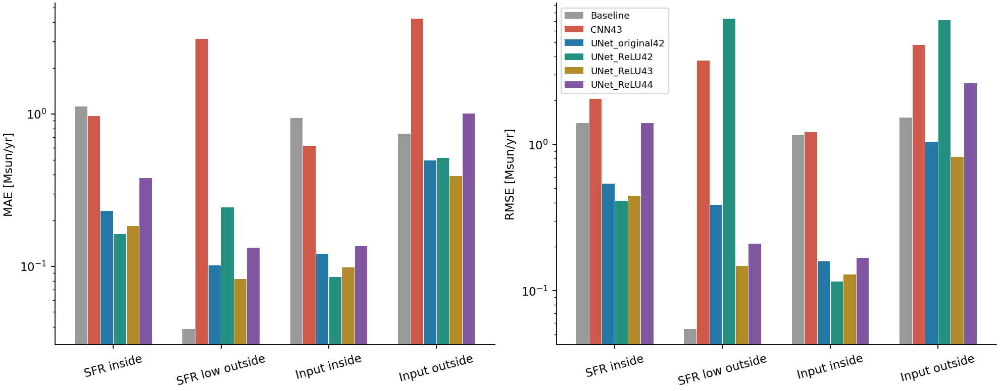
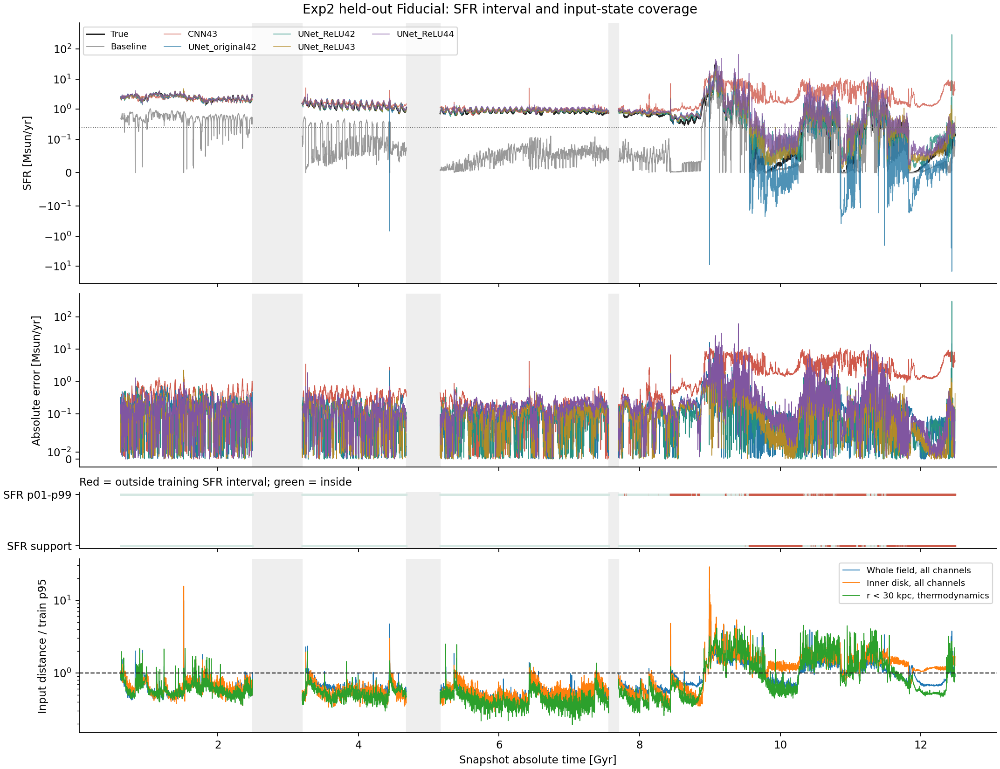

# Held-out Fiducial Exp2：CNN 与 UNet 的域内外表现

日期：2026-11-08。证据类型：实际缓存、训练元数据、已保存正式预测、重新计算的输入距离及测试。
本次没有训练、HPO、重新推理或修改原始预测。全部8429帧进入统计，负值和尖峰均保留。

## 主要判断

1. UNet 学习方案显著改善了 CNN 在留出 Fiducial 上的平均误差，且改善不限于训练 SFR 范围内。
2. 低于训练 SFR 下限时，所有这里检查的 UNet 的 MAE/RMSE 仍劣于 MACER-LR baseline。
   因而“比 CNN 好”不能写成“低 SFR 外推已经可靠”。
3. 输入近邻覆盖不足时，UNet 的 MAE 也明显优于 CNN，但 ReLU 多种子暴露出极端正尖峰和稳定性问题。
   三个新种子的域外 MAE 为0.391–1.006，RMSE为0.822–7.095；不能只选 seed43 宣称非负约束全面有效。
4. “总 SFR 在训练范围内”与“输入物理场被覆盖”不等价。两者应分别报告，并检查交叉分层。

## 样本与实验身份

统一数据为 `Exp2_Rh12x20_FiveRuns_Closure_v7_LOO_disk_galaxy_fiducial_`；
训练是 Fiducial4、Fiducial7、Model0.75、Model1.1，Fiducial 为唯一 out。
去除训练过采样重复 UID 后有10621个训练 snapshot，out有8429帧，绝对时间0.62000–12.48750 Gyr。
所有模型使用相同 Y/B、UID、parent 和12个输入通道；UNet 的 train/out cache SHA256 与当前文件一致。
实际损失、位置编码、容量、优化与逐格监督不同，这不是纯架构消融。

CNN43 在 Train_history 登记，但其紧邻命令实际上是 Trial7；本次以各自 hyperparameters.json 和预测文件为准，
同时给出两组，避免混淆。CNN43 的实际 batch_size=64、pos_max_freq=101，Trial7 为512、2。

ReLU 均为 Candidate1，表中区分首次11/06与后续11/07的 seed42；它们是不同完成训练。
三个新种子按预定同权重组全部报告，不按 out 表现选优，也不把它们的不同预测混成一个模型。
完整来源、参数、验证分数和 SHA256 见 method.json。

## 一、按训练集 SFR 范围划分

主定义为去重训练集的 min–max：**0.246136–84.088710 Msun/yr**，端点算范围内。
Fiducial 自身范围为0–34.078099。因此没有高端 SFR 域外帧；主峰本身仍在训练标签范围内。
把该主峰直接称为“训练未见的高 SFR”与当前四个训练运行的实际数据不符。

- 范围内：6661帧（79.02%）。
- 范围外：1768帧（20.98%），全部低于0.246136。
- 首次低端越界为9.45375 Gyr，此后与范围内交错；并不是9.45375之后的每一帧都越界。
  较长低端区间包括9.56125–10.32625、10.85125–11.09125、11.81625–12.48750 Gyr。
  这只是当前缓存采样的连续分类段，不是吸积事件的物理起止。

以下单位均为 Msun/yr，范围外为低端：

|模型|范围内 MAE / RMSE|范围外 MAE / RMSE|
|---|---:|---:|
|MACER-LR baseline|1.1216 / 1.4042|0.0386 / 0.0545|
|CNN Trial43 seed42|0.9643 / 2.0557|3.0993 / 3.7442|
|CNN Trial7 seed42|0.8243 / 1.7659|2.4269 / 3.0539|
|原始 UNet seed42|0.2305 / 0.5378|0.1014 / 0.3858|
|首次 ReLU seed42（11/06）|0.3115 / 7.3350|0.1772 / 4.0204|
|ReLU seed42（11/07）|0.1627 / 0.4104|0.2427 / 7.2504|
|ReLU seed43（11/07）|0.1840 / 0.4470|0.0826 / 0.1474|
|ReLU seed44（11/07）|0.3797 / 1.3951|0.1321 / 0.2091|

原始 UNet 相对 CNN43 的 MAE 在范围内降低76.1%，低端范围外降低96.7%；相对 CNN7 的判断也一致。
但低端 baseline 的 MAE仅0.03865，原始 UNet 为0.10139，三个新 ReLU 为0.08259–0.24270。
原始 UNet 在这个低端子集中有42.31%的总预测为负；它的低绝对误差不等同于物理输出可靠。
CNN43 低端 Bias=+3.09929，说明其问题主要是持续大幅高估。

### 标签阈值敏感性

p01–p99为0.554454–67.989606：范围内5946帧，范围外2483帧，仍全部是低端。
CNN43 / 原始 UNet 的范围外 MAE分别为2.92383 / 0.13848，改善仍成立；
baseline=0.11782，新 ReLU seed43=0.11623，已接近，说明“低端 baseline 最优”的强弱随阈值而变。
p05–p95为1.442962–35.034244，也没有高端域外，但会将6220帧划到低端。
因此 min–max 用于字面范围外，中心分位数只作为常见标签区间的敏感性，不把它们当作唯一自然边界。

## 二、按 LR 输入物理场覆盖划分

只用实际 train：每训练运行最多192个按物理时间选择的锚点；每组最多64个校准锚点。
距离为参考库逐通道标准化的全场 RMS，使用全部12个模型输入通道，无 SFR/closure/baseline 标签。
校准近邻时排除同运行相隔不足0.25 Gyr的帧；主阈值是校准距离p95=0.780196。
同一距离标尺下，覆盖6562帧（77.85%），未覆盖1867帧（22.15%）。
这是有限参考库与指定距离的覆盖代理，不是物理支持集或域外概率的严格证明。

|模型|范围内 MAE / RMSE|范围外 MAE / RMSE|
|---|---:|---:|
|MACER-LR baseline|0.9385 / 1.1551|0.7397 / 1.5324|
|CNN Trial43 seed42|0.6152 / 1.2141|4.2129 / 4.8137|
|CNN Trial7 seed42|0.5484 / 1.0391|3.3118 / 4.0202|
|原始 UNet seed42|0.1205 / 0.1588|0.4947 / 1.0413|
|首次 ReLU seed42（11/06）|0.1042 / 0.1368|0.9129 / 14.3943|
|ReLU seed42（11/07）|0.0849 / 0.1150|0.5119 / 7.0947|
|ReLU seed43（11/07）|0.0978 / 0.1288|0.3909 / 0.8217|
|ReLU seed44（11/07）|0.1348 / 0.1671|1.0058 / 2.6244|

原始 UNet 相对 CNN43：覆盖内 MAE降低80.4%，未覆盖时降低88.3%；对 CNN7 也均改善。
三个新 ReLU 的覆盖内 MAE为0.0849–0.1348，未覆盖时为0.3909–1.0058。
所有 UNet 的 MAE都优于 CNN，但 ReLU seed42 的域外 RMSE=7.0947，劣于 CNN43 的4.8137。
因此“更好的平均预测”与“更可靠的极端状态输出”必须分开判断。

### 输入度量敏感性

将全场校准阈值改为p90或p99，CNN43与原始 UNet的域外 MAE分别为：

|输入阈值|域外帧数|CNN43 MAE|原始 UNet MAE|
|---|---:|---:|---:|
|p90|2356|3.8268|0.4165|
|p95|1867|4.2129|0.4947|
|p99|447|5.1480|0.9485|

改用 r<10 kpc、abs(cos theta)<0.3 的内盘12通道，域外2809帧，
CNN43/原始 UNet MAE为3.5261/0.3409，方向一致。覆盖比例明显变化，说明空间窗口对“OOD”判定有影响。
r<30 kpc的 density/temperature/cooling_time 三通道结果也保存在 metrics.csv，
不同表示的距离不在同一标尺，不能把覆盖率差当作某输入通道的因果贡献。

## 三、交叉分类：两种“域外”并不一致

|SFR范围|输入覆盖|帧数|CNN43 MAE|原始 UNet MAE|Baseline MAE|
|---|---|---:|---:|---:|---:|
|内|内|5464|0.2693|0.1318|1.1207|
|内|外|1197|4.1365|0.6811|1.1254|
|外|内|1098|2.3365|0.0646|0.0314|
|外|外|670|4.3493|0.1618|0.0505|

特别是1197帧，SFR没有超出训练范围，输入覆盖却不足，CNN误差明显增大。
反过来1098帧，SFR越界但全场距离仍在阈值内。后者也提醒全场平均距离可能遗漏少数关键单元或物理关系的变化。
这比只比较早期与晚期更能区分标签范围、输入覆盖和映射学习问题；但仍是关联诊断，不能证明失效的单一原因。

## 四、爆发附近与低 SFR 晚期

9–10 Gyr只作为描述性窗口，不声称是论文已核验的 accretion burst 起止。
在这799帧中，CNN43、原始 UNet、新 ReLU seed42/43/44 的 MAE分别为
4.2120、0.6046、0.4197、0.4945、1.3411；baseline为0.9970。
所以原始 UNet和新ReLU42/43明显改善该窗口，seed44的MAE则不及baseline。
这些帧混有高/低 SFR，不能把整个窗口视为同一标签域外类别。

真实主峰在9.08625 Gyr、34.07810 Msun/yr，属于 SFR 范围内而输入域外，
其全场距离/阈值约2.32。原始UNet在8.99375 Gyr的最大误差点同样是SFR范围内而输入域外，
True=7.29264、预测=-8.93384、距离/阈值约14.41。

新 ReLU seed42 在12.44125 Gyr、True=0.07955时预测304.88341；
这一帧占其全轨迹平方误差的98.77%，属于标签和输入双域外。
seed44在9.405 Gyr、True=4.87505时预测66.72516，标签范围内、输入域外。
本报告保留全部这些异常，不用删除它们获得更好的模型排名。

## 五、时间相关性与解释边界

采用0.25 Gyr固定时间块、2000次配对bootstrap，原始 UNet−CNN43 的 MAE差：

|分类|MAE差|95%时间块区间|
|---|---:|---:|
|SFR范围内|-0.7338|[-1.2073,-0.3542]|
|SFR范围外|-2.9979|[-3.8363,-2.3769]|
|输入覆盖内|-0.4947|[-0.7569,-0.2775]|
|输入覆盖外|-3.7181|[-4.1583,-3.1795]|

0.5 Gyr块宽下方向一致，完整区间见 paired_block_bootstrap.csv。
这只描述给定训练模型、单个留出运行的轨迹差异，不代表跨独立星系/训练种子的总体置信区间。
特别是只有一个CNN种子，不能据此证明UNet架构具有普遍统计优势。
结构、逐格标签、损失空间、容量和HPO不同，当前证据支持“这些已训练UNet方案优于这些CNN方案”，
不能把收益全部归因于UNet结构，也不能把filtered MACER的结果外推为真实GIZMO泛化。

## 图表与复算





- metrics.csv：全部定义与模型的 MAE/RMSE/R²/Bias/相对误差。
- time_segments.csv：连续分类段，显式切断3处大缺口；绘图也断线。
- train_sfr_by_run.csv：实际去重训练分布。
- predictions_and_domains.csv：本地逐帧明细，可由脚本复算，不提交版本控制。
- method.json：所有来源、hash、真实超参数、单位和阈值。

验证命令：

```powershell
C:/Users/augus/miniconda3/python.exe VisualScripts/ResultAnalysis/compare_fiducial_domains.py --output-dir VisualScripts/ResultAnalysis/outputs/新的独立目录
C:/Users/augus/miniconda3/python.exe -m unittest tests.test_fiducial_domains tests.test_analyze_sfr_unet -q
```

本次实际全量运行完成；9项测试通过。核验了所有模型的身份、Y/B、单位、cache摘要和预测恒等式。
人工检查两张PNG并修正了缺口连线和分层行布局。
未开展新训练、其他留出星系模型比较、严格时间块重新训练或独立模拟泛化验证。
