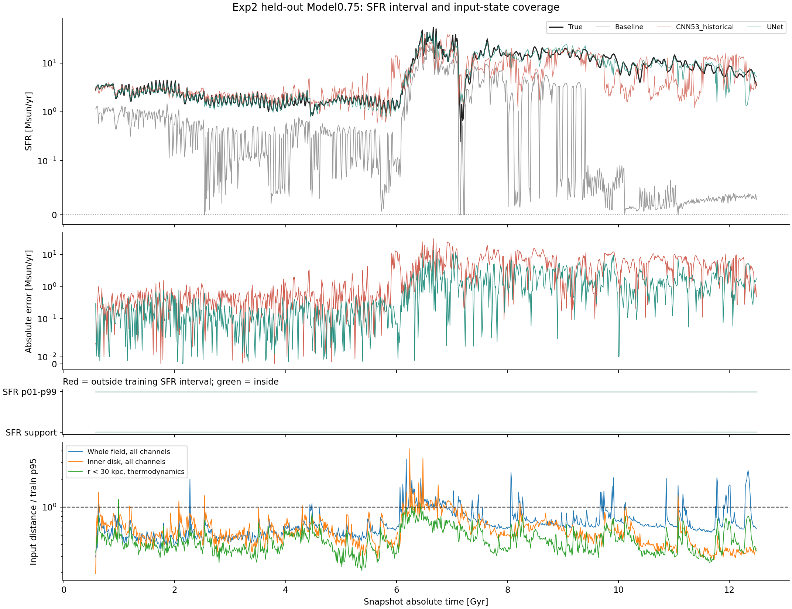
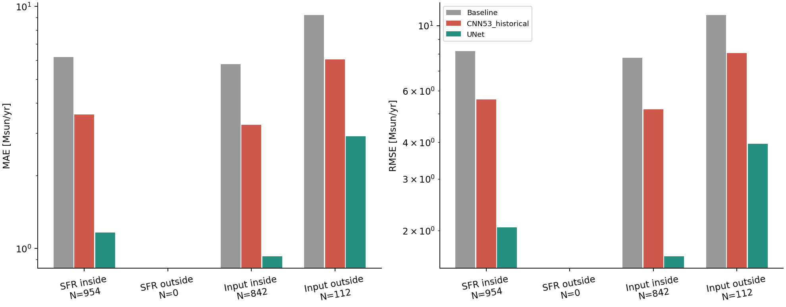

# Model0.75 Exp2：SFR 范围与输入覆盖分层

日期：2026-11-10。证据类型：正式结果、cache/metadata/UID、实际预测与距离计算、测试。
未重新训练或推理，保留全部954帧；所有误差为总SFR的物理空间 Msun/yr。

## 结论

UNet在输入覆盖内和覆盖外均优于历史CNN Trial53及MACER-LR baseline，
但覆盖外仍有明显幅值误差，真实主峰低估约25%。没有出现Fiducial某些种子那样由单帧假尖峰主导的RMSE。
本折在训练标签min–max及p01–p99内覆盖全部留出帧，不能把后期高SFR一律称为标签域外。

## 数据与比较边界

UNet：`Exp2_LOO_Model075_SFRUNet_ReLU_Candidate1_Final_20261109_142102_519eb27d`。
status=complete、hpo=false、seed42、best epoch99/实际100轮、ReLU、Candidate1，验证分数0.0018063673。
其cache为`Exp2_Rh12x20_UNet_Model075_v7_Closure_LOO_disk_galaxy_model_0_75_`。
训练是Fiducial/Fiducial4/Fiducial7/Model1.1，train去重15106帧，out954帧，绝对时间0.575–12.4875 Gyr。

CNN：Train_history登记的`Exp2_Rh12x20_FiveRuns_Closure_LOO_Model075_Trial53_Final_20260913_004906`。
其训练缓存不同，去重15187个UID，与新train交集9192；旧/新独有UID分别5995/5914。
不能仅根据总帧数接近就称它们有相同split或训练样本。
但是旧/新out的UID、parent、时间、Y、B和坐标完全一致，撤销各自标准化后的输入最大差3.64e-12。
旧train/out也通过身份隔离。因此表中比较是同一测试集上的历史方案对照，**不是控制训练数据的纯架构消融**。
所有输入距离与标签阈值统一依据新UNet的train，历史CNN不参与定义它们。

所有UNet的cache、norm、metadata SHA256与训练contract匹配，地图求和、ReLU、B+C_hat和跨split身份隔离通过。
CNN为原始预测CSV；只将code SFR乘0.025，不把log目标空间误差混入表格。

## 标签范围分层

去重train范围0–84.358398；out范围0.246136–54.078739。
全部954帧在min–max内，无低端或高端范围外样本；p01–p99=0.005608–64.897245时仍全部在内。
因此本折无法估计“标签范围外预测能力”，不能把空组误差写成0。
p05–p95=0.078541–29.476008时有16帧高于常见标签区间，UNet MAE/RMSE=6.3234/7.6329，
历史CNN=14.3363/16.1504；这是稀有高值诊断，不能改写为超出完整训练范围。

|模型|全体/标签范围内|
|---|---:|
|Baseline|6.1887 / 8.1924|
|CNN53_historical|3.5744 / 5.5994|
|UNet|1.1624 / 2.0480|

## 输入场覆盖分层

仅用新实际train，每训练运行最多192个时间锚点、每组最多64个校准点；
校准时排除同运行相隔不足0.25 Gyr的近邻。12通道全场标准化RMS近邻距离p95阈值=0.856822。
输入覆盖内842帧（88.26%），覆盖外112帧（11.74%）。
这只是指定表示与有限参考库的覆盖代理，不是物理支持集的严格证明。

|模型|覆盖内 MAE / RMSE|覆盖外 MAE / RMSE|
|---|---:|---:|
|Baseline|5.7836 / 7.7650|9.2347 / 10.8810|
|CNN53_historical|3.2471 / 5.1856|6.0356 / 8.0562|
|UNet|0.9302 / 1.6357|2.9085 / 3.9511|

UNet相对历史CNN的MAE改善分别为71.4%和51.8%；覆盖外Bias=-2.1230，以低估为主。
虽然总体优势明显，UNet覆盖外MAE仍约为覆盖内的3.13倍。

### 度量敏感性

|定义|覆盖外N|CNN MAE|UNet MAE|
|---|---:|---:|---:|
|全场p90|205|6.0586|2.4663|
|全场p95|112|6.0356|2.9085|
|全场p99|24|4.5019|4.2905|
|内盘12通道p95|57|8.5943|2.9163|
|r<30kpc热力学p95|3|3.9106|1.0788|

在p99识别的24帧最远状态上，优势已经显著缩小，不能笼统声称所有域外状态都改善一半。
热力学三通道只有3帧越界，样本过少，且不能拿不同表示的覆盖率直接推断通道因果作用。

## 时间、主峰与积分

t<6和t≥6仅为与既有分析接续的描述性窗口，不认定为独立核验的物理burst起止。
两窗中UNet MAE为0.1577/2.0010，历史CNN为0.6206/6.0398，baseline为1.5813/10.0342。
后期误差更大，但不能据此把全部后期帧划为输入或标签域外。

真实主峰6.6625 Gyr：True=54.07874，UNet=40.49178，CNN=22.38475，baseline=19.97627。
UNet在真实峰时低估25.12%，输入距离/阈值=1.0864，标签在训练范围内。
最大误差帧也是这个主峰；单帧平方误差占4.61%，前10帧占25.89%，不由一两个异常假峰主导。

观测区间无大缺口，覆盖11.9125 Gyr；同一梯形积分下，累计质量误差：
UNet=-1.8786%，CNN=-17.1787%，baseline=-79.2626%。
这些是该缓存区间的SFR积分，不等于日志NEWstar；积分接近不代表每个时刻都准确。
数值与用户现有analysis中的UNet瞬时统计及累计积分交叉核对一致。

## 时间相关性与验证

UNet−历史CNN的配对MAE差，0.25 Gyr时间块、2000次bootstrap：
覆盖内-2.3169，95%区间[-3.0787,-1.5987]；覆盖外-3.1272，区间[-4.4883,-1.2589]。
0.5 Gyr下方向一致。区间仅描述给定模型、该条轨迹的条件差异，不涵盖训练数据、种子或独立运行间不确定性。

本次两折CLI完成，10项相关测试通过；PNG人工检查；未训练、未筛除异常帧或按out选参。
缺少使用相同新cache的CNN及多种子对照；也未独立验证真实GIZMO泛化。
复算入口与参数见../../compare_fiducial_domains.md；来源及SHA256见method.json。

